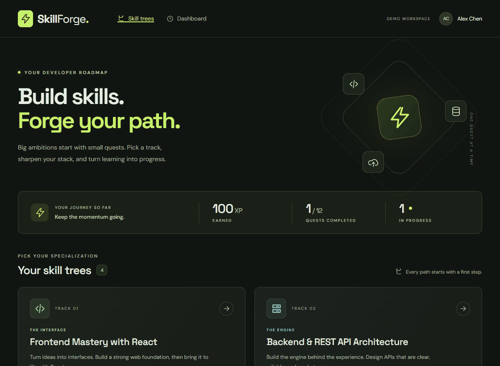
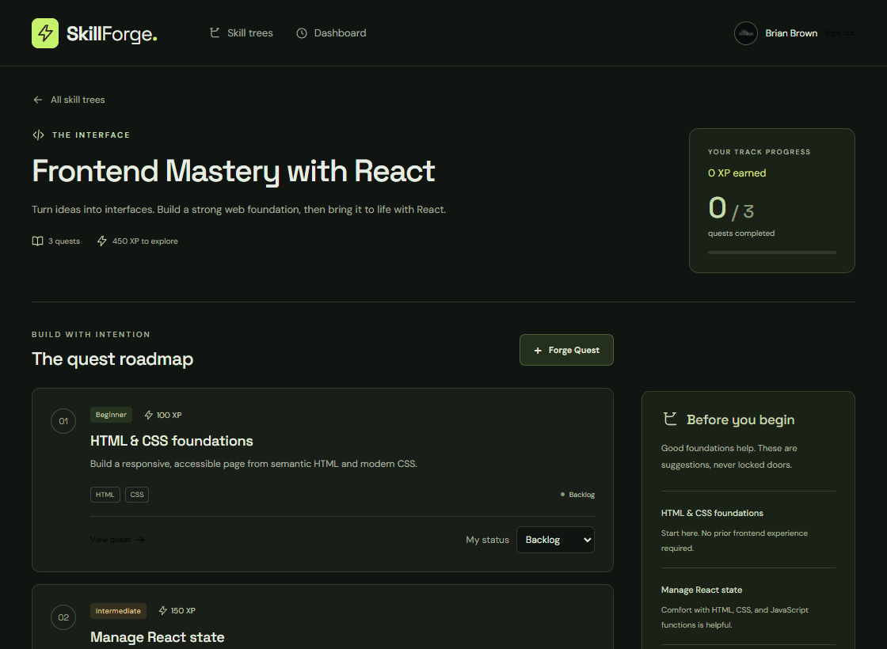
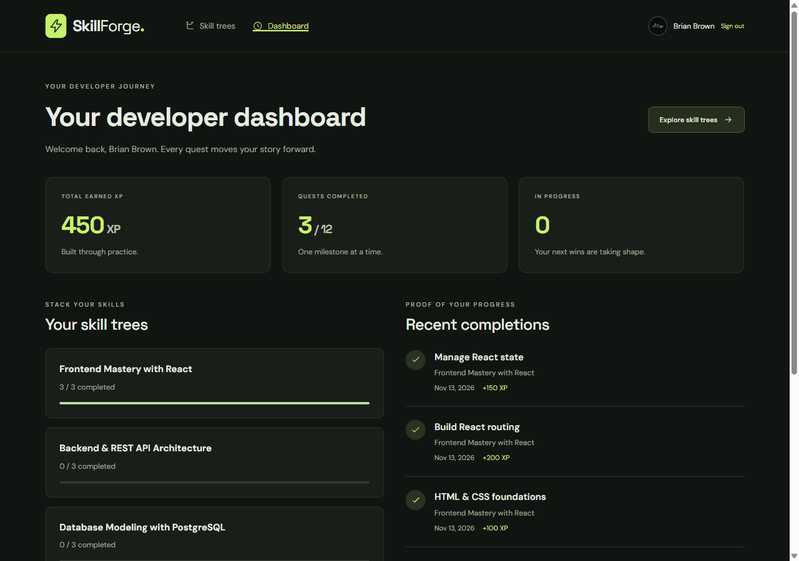
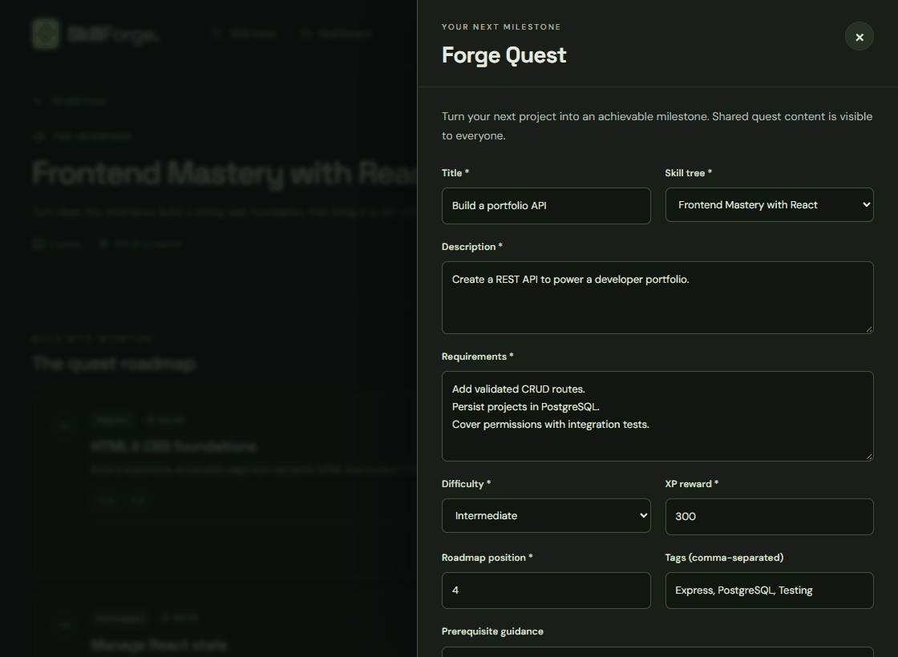
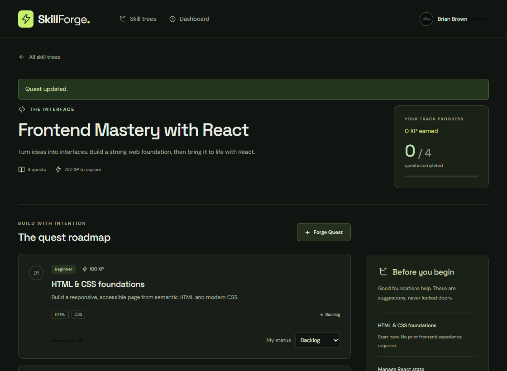
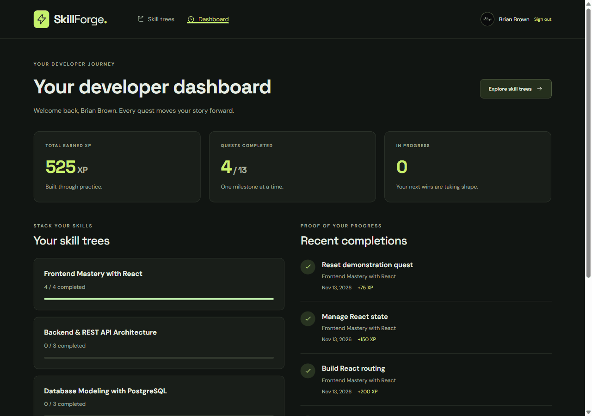
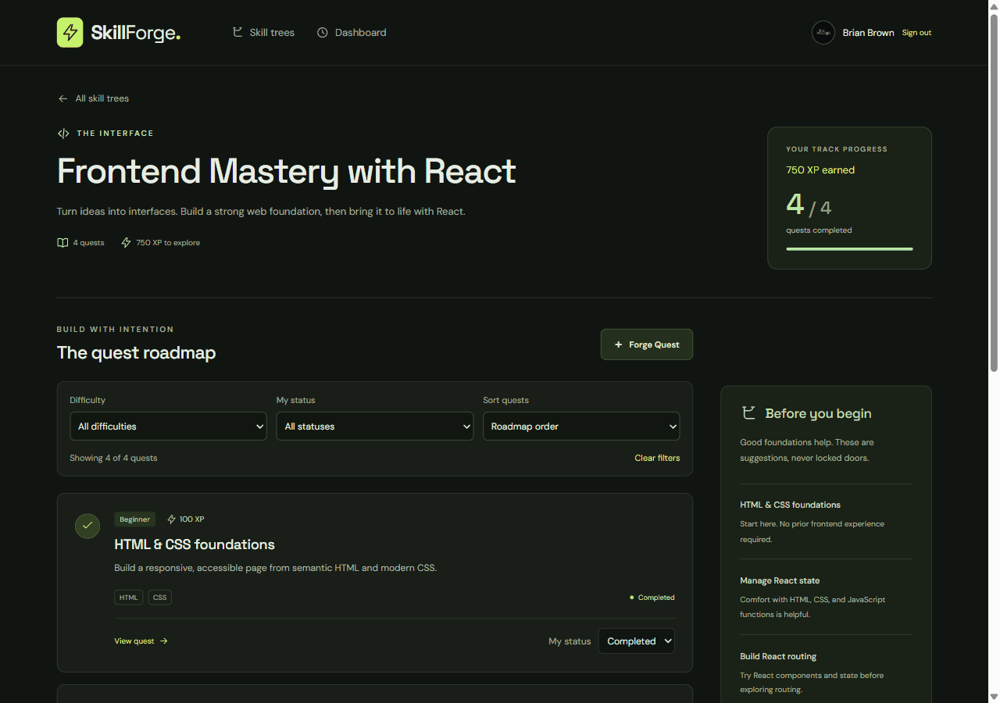
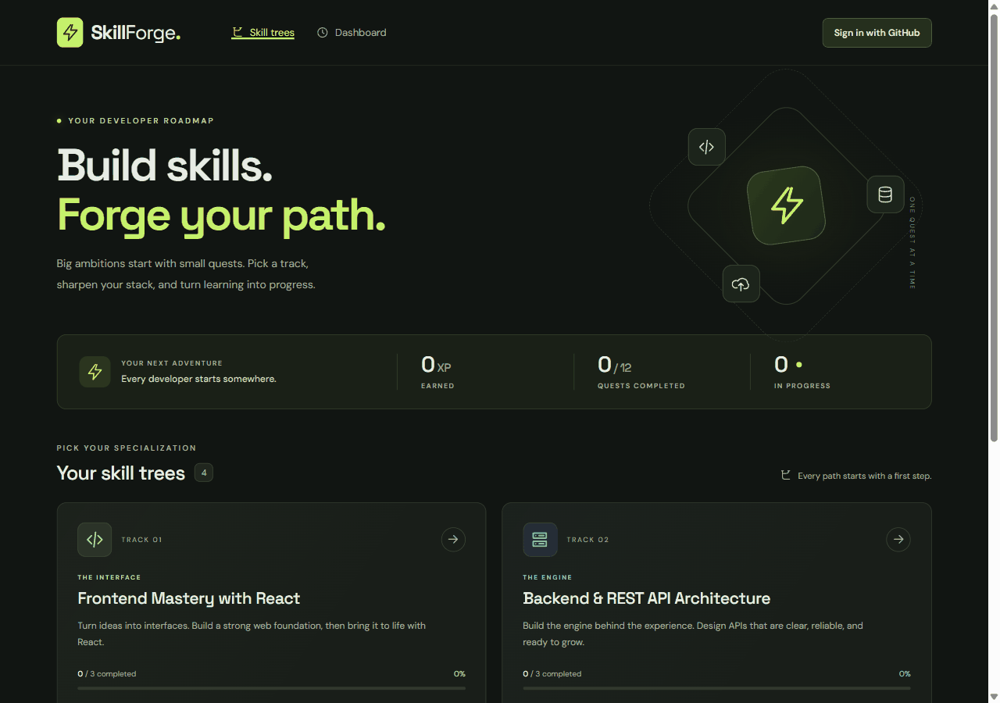

# SkillForge

CodePath WEB103 Final Project

Designed and developed by: Dilasha Shakya, Erika Villalpando, Manas Singh Bhati, Muhais Olatundun, Brian Brown

🔗 Link to deployed app: [SkillForge on Render](https://skillforge-ckbo.onrender.com/)

## About

### Description and Purpose

**SkillForge** is an RPG-inspired skill tree and technical quest management web application designed specifically for **aspiring and junior web developers**. 

Navigating the modern web development landscape (React, Node/Express, PostgreSQL, system architecture, and cloud deployment) can feel overwhelming and fragmented. SkillForge transforms tech roadmaps into gamified **Skill Trees** and bite-sized **Coding Quests**. Developers earn Dev XP, log milestone progress, track project deliverables, and conquer full-stack competencies one milestone at a time—turning the daunting journey of learning to code into an engaging adventure.

### Inspiration

SkillForge draws inspiration from:
- **GOATPath** (CodePath Exemplar): Providing structured career roadmaps and milestones for aspiring tech professionals.
- **Developer Roadmaps (roadmap.sh)**: Visualizing full-stack engineering specializations and essential prerequisite skills.
- **Classic RPG Skill Trees (e.g., Skyrim, World of Warcraft)**: Giving tangible visual progression, unlockable tiers, and level-up milestones.
- **Habitica**: Utilizing gamified accountability and reward loops to encourage consistent daily coding habits.

## Tech Stack

**Frontend:**
- React (Vite)
- React Router (Dynamic client-side routing & page redirection)
- Modern Vanilla CSS (Sleek dark mode developer aesthetic, glassmorphic cards, fluid status animations)

**Backend:**
- Node.js & Express.js (RESTful API architecture)
- PostgreSQL (Relational database hosted on Render)
- `pg` (node-postgres connection pool)

**Deployment:**
- Render (one Node Web Service serving the built React frontend, Express API, and GitHub authentication)

---

## Features

Completed features are marked ✅. Toast notifications remain tracked separately in teammate-owned issue #15.

### ✅ 1. Interactive Web Dev Skill Tree Explorer
Explore specialized developer tracks (e.g., *Frontend Mastery with React*, *Backend & REST API Architecture*, *Database Modeling with PostgreSQL*, and *DevOps & Cloud Deployment*). Clicking into any tree loads dynamic routes (`/trees/:id`) that display sequential coding milestones, prerequisites, and completion progress.
- **Relational Model:** 1-to-Many (`SkillTrees` -> `Quests`).



Completed in Milestone 3: the Explorer, dynamic tree detail pages, persisted demo progress summaries, responsive layouts, and loading/error/empty states. That walkthrough uses seeded developer **Alex Chen**. Milestone 4 adds GitHub sign-in, quest editing, and personal progress updates.

### ✅ 2. Full Quest & Project Lifecycle Management (RESTful CRUD)
Developers can manage both core roadmap milestones and custom portfolio challenges. Users can view challenges (`GET`), forge new custom coding quests (`POST`), update requirements, difficulty, and Dev XP rewards (`PATCH`), or remove outdated quests (`DELETE`).
- **Relational Model:** RESTful API with all 4 HTTP methods on `/api/quests`.



Completed in Milestone 4: database-backed creation, full details, partial updates and tree moves, creator/admin permissions, field validation, and cascading deletion of personal progress.

### ✅ 3. Developer Progression & XP Tracker
Developers track their journey as they take on quests. Progress, completion timestamps, earned Dev XP, and repository links/notes are recorded in a dedicated join table.
- **Relational Model & Custom Feature:** Many-to-Many (`Users` <-> `Quests` via `user_quests` join table featuring unique fields: `status`, `xp_earned`, `completed_at`, and `notes`).



### ✅ 4. Quest Forge Modal / Slide-Out Pane
Allows developers to forge new custom coding quests or view deep-dive project criteria within a responsive, accessible modal overlay without navigating away from their current roadmap view.
- **Custom Feature:** Slide-out pane / modal dialog.



### ✅ 5. In-Place Coding Milestone Status Toggle
Toggle quest statuses (e.g., from *In Progress* to *Completed*) directly on the page without triggering a page reload or URL change, instantly updating developer XP totals and badge states.
- **Baseline Feature:** Interactive in-page state update.



### ✅ 6. Database Default State Reset
A dedicated reset feature that restores the PostgreSQL database to its clean default state pre-loaded with curated developer skill tracks, standard coding challenges, and starter progress.
- **Baseline Feature:** Database reset endpoint & seed script (`POST /api/reset`).



### 7. Action Feedback & Toast Notification System (Stretch Feature)
Delivers immediate feedback via toast alerts when quests are created, edited, or completed, accompanied by loading spinners and dynamic button disabling during async submissions.
- **Stretch Feature:** Polished UX states & toast alerts.

---


### ✅ 8. Quest Filtering & Sorting (Custom Feature)
Filter a roadmap by difficulty and personal status, or sort by roadmap order, highest XP, and title. Combined filters show matching counts without changing the full track completion or XP totals. Public visitors can filter difficulty and sort; personal-status filtering requires sign-in.



## Final Project Walkthrough

SkillForge is deployed at [the public Render app](https://skillforge-ckbo.onrender.com/). Real GitHub sessions, CRUD, progress, dashboard links, filtering, and owner-confirmed reset were verified on the deployed application. See the [deployment runbook](docs/render-deployment.md) and [M5 progress report](milestones/progress_report_5.md). Toast work remains teammate-owned.



## Installation Instructions

### Prerequisites
- Node.js **24.x** and npm (the version is also recorded in `.nvmrc`)
- A dedicated PostgreSQL database; this milestone uses Render PostgreSQL with TLS

Commands below run from the repository root. In Windows PowerShell, use `npm.cmd` in place of `npm` if script execution policy blocks `npm.ps1`.

### 1. Clone the repository
```bash
git clone https://github.com/bbdevelops/web103_finalproject.git
cd web103_finalproject
```

### 2. Install and configure
```bash
npm install
cp .env.example .env
```

For a fresh clone, fill in the root `.env` with your database settings. Keep an existing configured `.env` when updating the repository. PowerShell also supports `Copy-Item .env.example .env` for the copy step.

Use Render's **external** hostname, database, user, and password in `PGHOST`, `PGDATABASE`, `PGUSER`, and `PGPASSWORD`; set `PGPORT=5432` and `PGSSLMODE=require`. Alternatively, set `DATABASE_URL`, which takes precedence over the individual connection fields. The backend loads this root file even when started from `server/`. Keep credentials out of source control.

### 3. Seed the database
```bash
npm run seed
```

The seed command transactionally rebuilds the project's four domain tables, so use a dedicated development database. It creates four tracks, twelve quests, a demo developer and admin, and starter progress. Alex starts with **100 XP**, **1/12 quests completed**, **1 in progress**, and **1/3 completed in React**. Repeated runs restore these defaults. The reusable catalog seed preserves identities/roles for the admin reset feature; the CLI schema rebuild is intended for development setup.

### 4. Start the application

Run these in separate terminals from the repository root:

```bash
npm run dev:server  # http://127.0.0.1:3001
```

```bash
npm run dev:client  # http://127.0.0.1:5173
```

The client proxies `/api` and `/auth` to Express. Open **http://127.0.0.1:5173** consistently so OAuth redirects and session cookies use the same host. The protected dashboard shows personal totals, per-tree progress, recent completions, and admin-only reset tools.

### GitHub sign-in setup

Register a development OAuth App in GitHub Settings → Developer settings → OAuth Apps. Set its homepage to `http://127.0.0.1:5173` and redirect URI to `http://127.0.0.1:5173/auth/callback`, with wildcard matching and Device Flow disabled. Copy the Client ID and generate a client secret, then configure the root `.env` privately:

```dotenv
CLIENT_ORIGIN=http://127.0.0.1:5173
GITHUB_CLIENT_ID=your_client_id
GITHUB_CLIENT_SECRET=your_client_secret
GITHUB_CALLBACK_URL=http://127.0.0.1:5173/auth/callback
SESSION_SECRET=a_private_random_secret
```

Generate the session secret locally with `node -e "console.log(require('crypto').randomBytes(32).toString('hex'))"`. Restart the API after changing configuration. PostgreSQL session storage is initialized automatically without rebuilding domain tables. Missing OAuth configuration leaves public browsing available and shows a retryable sign-in message.

Guests can browse shared content; mutations require a session. New GitHub accounts start with zero progress and do not inherit Alex's seeded progress. GitHub tokens are used during sign-in and discarded. Full development reseeding invalidates sessions; the reusable catalog seed preserves users and roles. Demo identities are explicit automated-test fixtures, never the default application account.

For M5 deployment, configure HTTPS, `NODE_ENV=production`, a production callback and client origin, proxy trust, Secure/SameSite=Lax cookies, and credentialed CORS. The server includes the environment-dependent session settings. See the single-service runbook for exact production values.

### Verification

```bash
npm test           # 32 PostgreSQL/API integration tests in disposable test schemas
npm run lint
npm run build
npm run test:browser
npm run test:oauth # Opens Chrome for interactive verification with a real GitHub account
```

The M5 browser suite starts its own API and Vite server on port 5174, uses a disposable PostgreSQL schema, and simulates only the external OAuth provider. It checks real application mutations, sessions, permissions in the UI, keyboard focus, mobile layouts, pending/error/retry behavior, loading, empty states, and missing routes. Development data is preserved. Chrome must be available; set `CHROME_PATH` for another executable, or install Playwright Chromium with `npx playwright install chromium`.

The separate real OAuth check requires the development servers running on ports 3001 and 5173. Complete login in its Chrome window; it verifies return navigation, refresh persistence, logout, and reauthentication. Session cookies and check artifacts remain under ignored `.artifacts/m4/` and must stay out of source control.

To rebuild the README GIF after recording, use Python with Pillow installed:

```bash
python scripts/build-demo-gif.py
# M4: after the real OAuth check, record actual app interactions and encode three GIFs
node scripts/record-m4.mjs
python scripts/build-demo-gif.py --milestone m4
```

### M5 deployment checks

```bash
npm run test:production
npm run test:deployed -- https://your-service.onrender.com
npm run test:oauth
```

The deployed smoke check saves the public origin under ignored `.artifacts/m5/`; the OAuth check then uses that origin. The OAuth check opens Chrome for interactive sign-in, return navigation, refresh persistence, logout, and the protected dashboard.

### Implemented API

| Method | Endpoint | Response |
| --- | --- | --- |
| GET | `/api/health` | Database health; 200 `{ "ok": true }` or 503 `{ "ok": false }` |
| GET | `/api/trees` | Trees, quest/completion counts, session user, and XP/progress summary |
| GET | `/api/trees/:id` | One tree and quests ordered by position then ID, with personal status |
| GET | `/api/quests/:id` | Full shared quest and current user's personal progress, or null |
| POST | `/api/quests` | Create a quest owned by the session user; 201 `{ quest }` |
| PATCH | `/api/quests/:id` | Creator/admin partial update; `{ quest }` |
| DELETE | `/api/quests/:id` | Creator/admin deletion with progress cascade; 204 |
| PUT | `/api/quests/:id/progress` | Save session user's status/notes/repository URL; `{ progress }` |
| GET | `/api/me/progress` | Authenticated `{ summary, trees, recent_completions }`; latest ten completions, newest first |
| POST | `/api/reset` | Admin-only transactional default catalog/progress reset; preserves accounts, roles, and sessions |
| GET | `/auth/github` | Start GitHub sign-in; accepts a local `returnTo` path |
| GET | `/auth/callback` | Verify OAuth state and establish a PostgreSQL-backed session |
| GET | `/auth/me` | Current `{ user }`, or 401 |
| POST | `/auth/logout` | Destroy session and clear cookie; 204 |

Quest writes accept `skill_tree_id`, `title`, `description`, `requirements`, `difficulty`, `xp_reward`, `position`, `prerequisite_notes`, `tech_stack_tags`, and `documentation_urls`. Required text cannot be blank; difficulty is `beginner`, `intermediate`, or `advanced`; XP and position are nonnegative integers; supplied links use HTTP(S). Validation returns 400 `{ error, errors }` with errors keyed by field. Writes return 401 when unsigned, 403 when unauthorized, and 404 for missing quests. Only admins manage seeded quests.

Progress accepts `status` (`backlog`, `in_progress`, `completed`), `notes`, and `repository_url`. Omitted fields preserve existing values; blank/null optional text clears it. Completion snapshots reward/time once, reopening clears that award/time, and later reward edits do not change saved awards. Ownership, roles, timestamps, and earned XP are server-controlled.

See the [Milestone 4 progress report](milestones/progress_report_4.md) for the completed sprint, verification, GIFs, and rubric evidence. The dashboard, deployment, and recorded evidence are documented in the [M5 progress report](milestones/progress_report_5.md).

See the [Milestone 3 progress report](milestones/progress_report_3.md), [completion plan](milestones/milestone3_plan.md), and [project board](https://github.com/users/bbdevelops/projects/2) for the sprint evidence.
