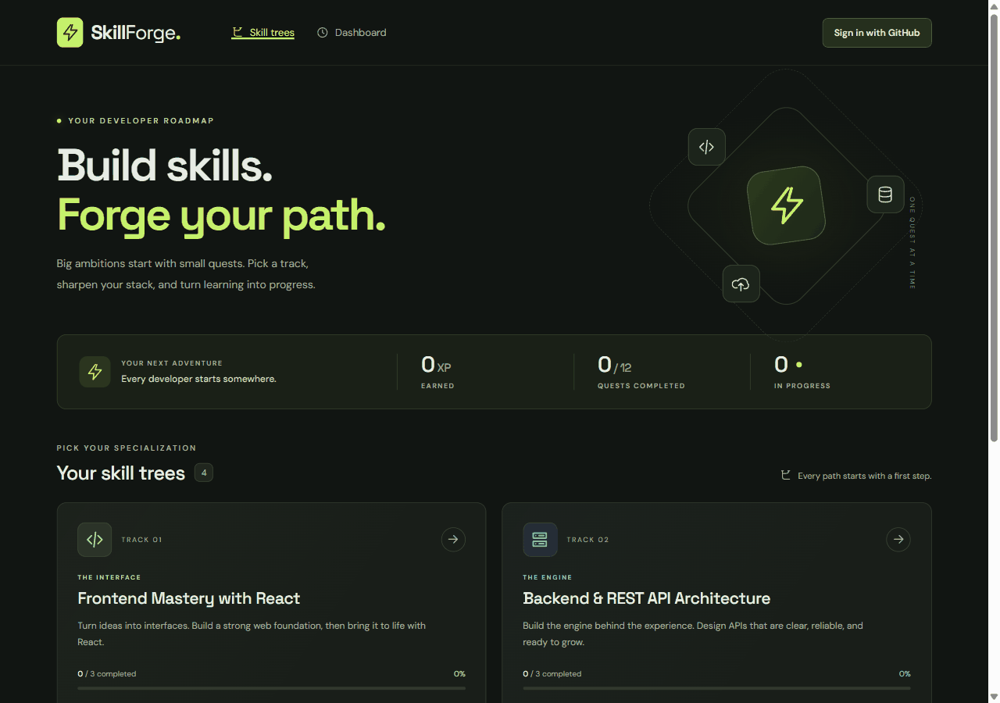

# Milestone 5

This document should be completed and submitted during **Unit 9** of this course. You **must** check off all completed tasks in this document in order to receive credit for your work.

## Checklist

This unit, be sure to complete all tasks listed below. To complete a task, place an `x` between the brackets.

- [x] Deploy your project on Render
  - [x] In `readme.md`, add the link to your deployed project
- [x] Update the status of issues in your project board as you complete them
- [x] In `readme.md`, check off the features you have completed in this unit by adding a ✅ emoji in front of their title
  - [x] Under each feature you have completed, **include a GIF** showing feature functionality
- [x] In this document, complete the **Reflection** section below
- [x] 🚩🚩🚩**Complete the Final Project Feature Checklist section below**, detailing each feature you completed in the project (ONLY include features you implemented, not features you planned)
- [x] 🚩🚩🚩**Record a GIF showing a complete run-through of your app** that displays all the components included in the **Final Project Feature Checklist** below
  - [x] Include this GIF in the **Final Demo GIF** section below

## Implementation and release status

All nine M5 issues are complete, including the teammate-contributed toast feature (#15) and follow-up cloud covers, one-to-one relationship, click guards, and final evidence (#25-#27). Production checks and the owner-confirmed reset recording passed. See the [M5 progress report](progress_report_5.md) for actual issue status and evidence.

## Final Project Feature Checklist

Complete the checklist below detailing each baseline, custom, and stretch feature you completed in your project. This checklist will help graders look for each feature in the GIF you submit.

### Baseline Features

Checked features are implemented and verified on [the deployed application](https://skillforge-ckbo.onrender.com/). The complete walkthrough is embedded below; source/schema/tests provide supporting architectural evidence.

- [x] The project includes an Express backend app and a React frontend app
- [x] The project includes these backend-specific features:
  - [x] At least one of each of the following database relationships in Postgres
    - [x] one-to-many
    - [x] many-to-many with a join table
  - [x] A well-designed RESTful API that:
    - [x] supports all four main request types for a single entity (ex. tasks in a to-do list app): GET, POST, PATCH, and DELETE
      - [x] the user can **view** items, such as tasks
      - [x] the user can **create** a new item, such as a task
      - [x] the user can **update** an existing item by changing some or all of its values, such as changing the title of task
      - [x] the user can **delete** an existing item, such as a task
    - [x] Routes follow proper naming conventions
  - [x] The web app includes the ability to reset the database to its default state
- [x] The project includes these frontend-specific features:
  - [x] At least one redirection, where users are able to navigate to a new page with a new URL within the app
  - [x] At least one interaction that the user can initiate and complete on the same page without navigating to a new page
  - [x] Dynamic frontend routes created with React Router
  - [x] Hierarchically designed React components
    - [x] Components broken down into categories, including Page and Component types
    - [x] Corresponding container components and presenter components as appropriate
- [x] The project includes dynamic routes for both frontend and backend apps
- [x] The project is deployed on Render with all pages and features that are visible to the user are working as intended

### Custom Features

Checked features are implemented and verified on [the deployed application](https://skillforge-ckbo.onrender.com/). The complete walkthrough is embedded below; source/schema/tests provide supporting architectural evidence.

- [x] The project gracefully handles errors
- [x] The project includes a one-to-one database relationship
- [x] The project includes a slide-out pane or modal as appropriate for your use case that pops up and covers the page content without navigating away from the current page
- [x] The project includes a unique field within the join table
- [x] The project includes a custom non-RESTful route with corresponding controller actions
- [x] The user can filter or sort items based on particular criteria as appropriate for your use case
- [x] Data is automatically generated in response to a certain event or user action. Examples include generating a default inventory for a new user starting a game or creating a starter set of tasks for a user creating a new task app account
- [x] Data submitted via a POST or PATCH request is validated before the database is updated (e.g. validating that an event is in the future before allowing a new event to be created)
  - [x] *To receive full credit, please be sure to demonstrate in your walkthrough that for certain inputs, the item will NOT be successfully created or updated.*

### Stretch Features

Checked features are implemented and verified on [the deployed application](https://skillforge-ckbo.onrender.com/). The complete walkthrough is embedded below; source/schema/tests provide supporting architectural evidence.

- [x] A subset of pages require the user to log in before accessing the content
  - [x] Users can log in and log out via GitHub OAuth with Passport.js
- [x] Restrict available user options dynamically, such as restricting available purchases based on a user's currency
- [x] Show a spinner while a page or page element is loading
- [x] Disable buttons and inputs during the form submission process
- [x] Disable buttons after they have been clicked
  - *At least 75% of buttons in your app must exhibit this behavior to receive full credit*
- [x] Users can upload images to the app and have them be stored on a cloud service
  - *A user profile picture does **NOT** count for this rubric item **only if** the app also includes "Login via GitHub" functionality.*
  - *Adding a photo via a URL does **NOT** count for this rubric item (for example, if the user provides a URL with an image to attach it to the post).*
  - *Selecting a photo from a list of provided photos does **NOT** count for this rubric item.*
- [x] 🍞 [Toast messages](https://www.patternfly.org/v3/pattern-library/communication/toast-notifications/index.html) deliver simple feedback in response to user events

## Final Demo GIF

[Open the deployed SkillForge application](https://skillforge-ckbo.onrender.com/)

The walkthrough uses real GitHub authentication, PostgreSQL-backed responses, and Cloudinary file uploads. Controlled browser network latency makes loading spinners and disabled pending controls readable; API responses are not mocked. The owner confirmed global reset after a fresh private backup of both the database and referenced image bytes. Live checks verified default data, preserved admin sessions, and completed cloud cleanup.

Separate feature recordings: [dashboard](../docs/gifs/m5-dashboard.gif), [reset](../docs/gifs/m5-database-reset.gif), [filtering/sorting](../docs/gifs/m5-quest-filters.gif), [cloud covers](../docs/gifs/m5-quest-covers.gif), and [click guards](../docs/gifs/m5-click-guards.gif). The teammate's [toast GIF](../docs/gifs/toaster-notifications.gif) is preserved. See [verification details](../docs/m5-verification.md) and the [archived original M5 walkthrough](../docs/gifs/archive/m5-2026-11-14/m5-final-walkthrough.gif).

## Reflection

### 1. What went well during this unit?

The existing schema, reusable panes, and transactional API supported the dashboard, filtering, admin reset, and cloud covers. All 46 API/database tests and 22 browser checks pass, alongside lint, build, routing checks, and real provider verification. The deployed walkthrough demonstrates actual GitHub sessions and Cloudinary uploads. The owner confirmed reset after a media-aware backup. Toast comparisons on desktop, mobile, and inside dialogs are pixel-identical to the teammate's merged implementation.

### 2. What were some challenges your group faced in this unit?

Authentication required handling protected-route logout races and canonical origins; browser checks and a trailing-slash regression test exposed and fixed those issues. Cloud storage introduced operations outside the database transaction, so failed saves compensate uploads and committed removals use retryable cleanup. The new foreign key required updating an older empty-catalog fixture. Backup/test contention exposed a global lock issue; scoping catalog locks to each schema fixed it. Shared button guards also had to preserve native validation, keyboard submission, focus restoration, and existing toast visuals.

### 3. What were some of the highlights or achievements that you are most proud of in this project?

The project connects a responsive React interface, Express API, PostgreSQL relationships, GitHub sessions, ownership checks, and consistent XP awards. Its strengths include accessible quest panes, concurrent completion snapshots, a database-enforced one-to-one cover relationship, and reset behavior that preserves identities while cleaning up remote assets. The team-contributed toast system remains visually intact, supported by source and pixel comparisons. The full deployed walkthrough provides authentic evidence of the completed features.

### 4. Reflecting on your web development journey so far, how have you grown since the beginning of the course?

The project records a progression from user stories and wireframes to relational modeling, validated APIs, stateful React interactions, OAuth, and automated integration checks. That work demonstrates broader full-stack skills than the initial static design: debugging behavior across browser, server, and database boundaries; protecting personal data; and turning acceptance criteria into repeatable verification.

### 5. Looking ahead, what are your goals related to web development, and what steps do you plan to take to achieve them?

The proposed next goals are to strengthen production deployment habits, improve automated release checks, and keep practicing accessible interfaces and reliable database changes. Useful next steps after the capstone are adding CI for the existing suites, reviewing production logs and deployment health, and building another small application with the same testing discipline.
