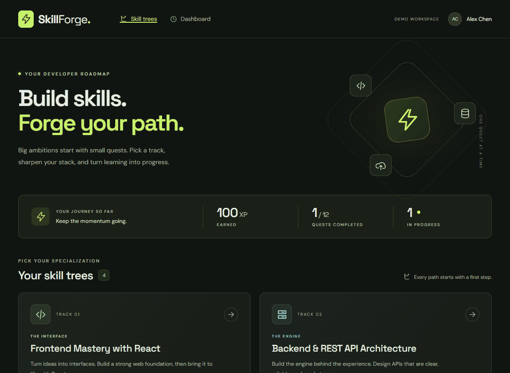

# Milestone 3 Progress Report

## GitHub Project Setup

Project board created: yes

Project board shared with codepathreview: yes

Project board: [SkillForge](https://github.com/users/bbdevelops/projects/2). The board is public; the project owner also confirmed explicit grader sharing. The in-class pitch has been delivered.

## Issues Created

- [Project concept, user stories, and feature list](https://github.com/bbdevelops/web103_finalproject/issues/1)
- [Wireframes and entity relationship diagram](https://github.com/bbdevelops/web103_finalproject/issues/2)
- [Scaffold React client and Express server](https://github.com/bbdevelops/web103_finalproject/issues/3)
- [Create PostgreSQL schema and seed script](https://github.com/bbdevelops/web103_finalproject/issues/4)
- [Skill Tree Explorer page and GET /api/trees](https://github.com/bbdevelops/web103_finalproject/issues/5)
- [Skill Tree Detail page (/trees/:id)](https://github.com/bbdevelops/web103_finalproject/issues/6)
- [Quest REST API (GET/POST/PATCH/DELETE /api/quests)](https://github.com/bbdevelops/web103_finalproject/issues/7)
- [Quest Forge pane: create and edit form](https://github.com/bbdevelops/web103_finalproject/issues/8)
- [Quest details pane with delete confirmation](https://github.com/bbdevelops/web103_finalproject/issues/9)
- [Progress API for user_quests](https://github.com/bbdevelops/web103_finalproject/issues/10)
- [In-place quest status toggle](https://github.com/bbdevelops/web103_finalproject/issues/11)
- [GitHub OAuth sign-in and sessions](https://github.com/bbdevelops/web103_finalproject/issues/12)
- [Developer Dashboard (/dashboard)](https://github.com/bbdevelops/web103_finalproject/issues/13)
- [Database reset endpoint and admin confirmation](https://github.com/bbdevelops/web103_finalproject/issues/14)
- [Toast notifications and pending states](https://github.com/bbdevelops/web103_finalproject/issues/15)
- [Deploy client and server to Render](https://github.com/bbdevelops/web103_finalproject/issues/16)

## GitHub Milestones Created

- [Milestone 1 - Unit 5](https://github.com/bbdevelops/web103_finalproject/milestone/1)
- [Milestone 2 - Unit 6](https://github.com/bbdevelops/web103_finalproject/milestone/2)
- [Milestone 3 - Unit 7](https://github.com/bbdevelops/web103_finalproject/milestone/3)
- [Milestone 4 - Unit 8](https://github.com/bbdevelops/web103_finalproject/milestone/4)
- [Milestone 5 - Unit 9](https://github.com/bbdevelops/web103_finalproject/milestone/5)

All three development milestones (M3–M5) exist, in addition to the earlier concept/design milestones.

## Milestone 3 Completion

Completion percentage for Milestone 3 - Unit 7: 100%

Issues completed this unit and their main implementation locations:

- Scaffold React client and Express server (#3) - `client/`, `server/app.js`, `server/index.js`, `server/middleware/user.js`, root workspace/environment configuration
- Create PostgreSQL schema and seed script (#4) - `server/db/schema.sql`, `server/db/catalog.js`, `server/db/seed.js`, `server/db/pool.js`
- Skill Tree Explorer page and GET /api/trees (#5) - `client/src/pages/ExplorerPage.jsx`, `client/src/components/TreeCard.jsx`, `server/routes/trees.js`
- Skill Tree Detail page (/trees/:id) (#6) - `client/src/pages/TreeDetailPage.jsx`, `client/src/components/QuestRow.jsx`, `server/routes/trees.js`

Issue #6 was moved from M4 into M3 to finish the entire browsing feature. All four M3 issues are complete. Their issue state and board status are Closed/Done, giving 4/4 = 100%. M1 and M2 are also 100%; M4 and M5 remain at 0% with their future work open.

## Features Completed This Unit

- Interactive Web Dev Skill Tree Explorer - marked ✅ in `README.md`; four database-backed tracks, dynamic tree pages, ordered quests, prerequisites, demo progress, responsive layouts, and loading/error/empty states.

The GIF records the running React/Express application connected to Render PostgreSQL. It shows the seeded 100 XP and 1/12 completed summary, track selection, quest statuses and prerequisites, refresh, returning to the Explorer, and opening another track. Only the browsing feature is marked complete; OAuth, quest editing, progress writes, the dashboard, and database reset remain future work.

## Verification

- `npm test`: 14 passing database/API integration tests against an isolated, disposable PostgreSQL schema.
- `npm run test:browser`: 13 passing Chrome checks, including real API data, navigation/refresh, 390px layout, keyboard skip link, retry/loading/empty states, and no uncaught browser errors.
- `npm run lint`: passes with no warnings.
- `npm run build`: production client build passes.
- Repeatable seed verified: four trees, twelve quests, two demo users, three progress rows; 100 XP, 1/12 completed, 1 active, and 1/3 completed in React.
- Test-schema cleanup and a failed-seed rollback are covered; application data is preserved during isolated tests.

## Grading Evidence

| Required criterion | Points | Evidence |
| --- | ---: | --- |
| GitHub project board created | 2 | Public SkillForge board linked above |
| At least five issues on the board | 5 | All 16 repository issues are on the board and listed above |
| All three development milestones created | 3 | M3, M4, and M5 linked above; M1/M2 also retained |
| Milestone 3 is 100% complete | 8 | Four completed M3 issues, closed and marked Done |
| All five reflection questions completed | 5 | [Milestone 3 reflection](milestone3.md#reflection) |
| At least one completed feature in this report | 1 | Interactive Web Dev Skill Tree Explorer |
| At least one feature GIF | 2 | Working GIF embedded here and beneath README Feature 1 |
| **Total criteria documented** | **26** | **All seven rubric criteria covered** |
