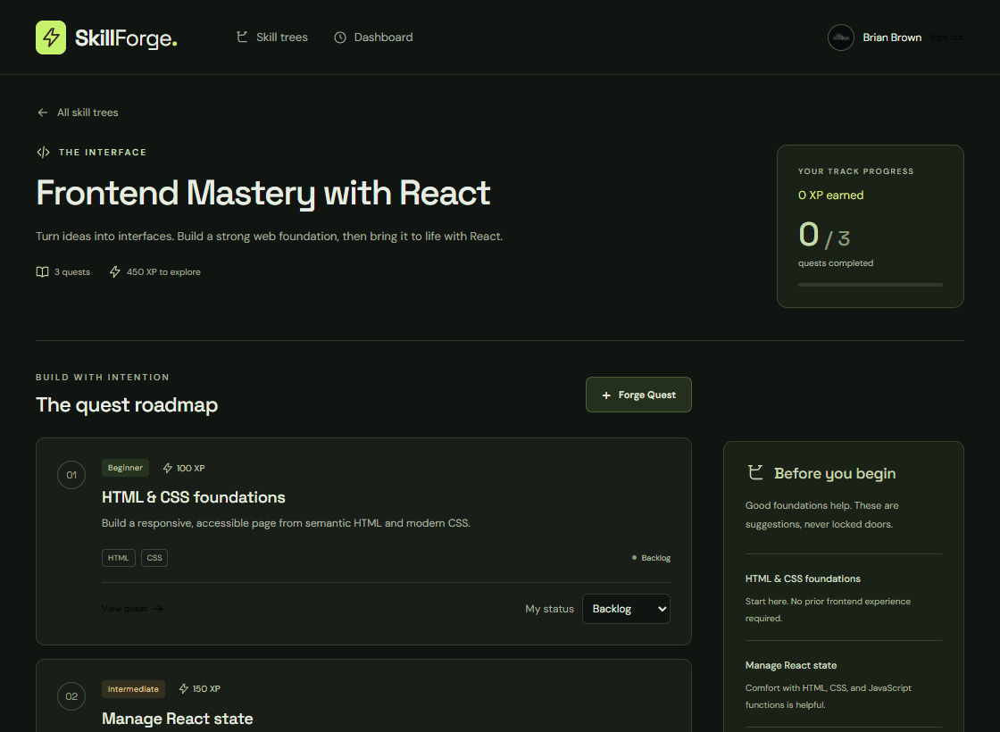
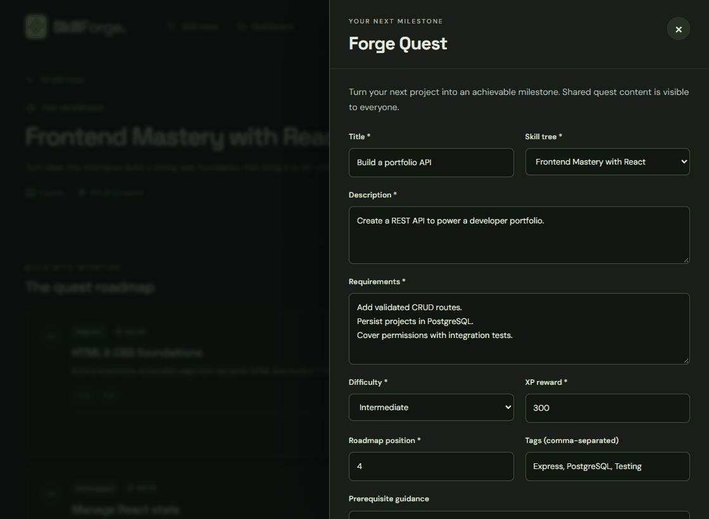
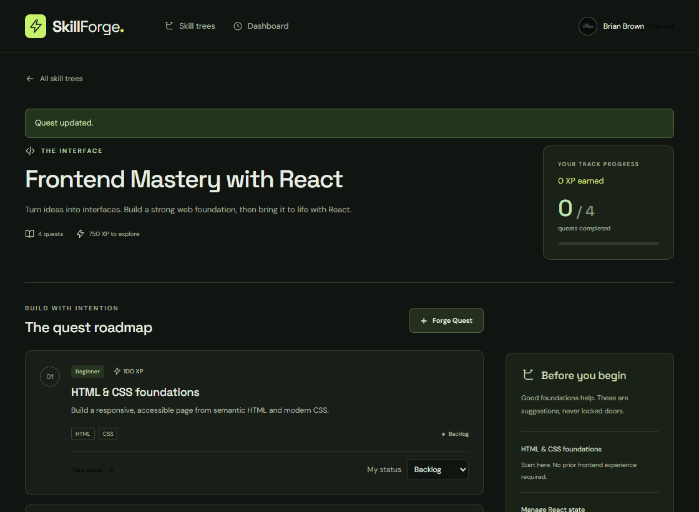

# Milestone 4 Progress Report

## Milestone 4 Completion
Completion percentage for Milestone 4 - Unit 8: 0%

All six issue implementations and acceptance checks are complete on the M4 branch. GitHub reconciliation and submission are in progress; the percentage above reflects issue state before those final updates.

- [#7: Quest REST API (GET/POST/PATCH/DELETE /api/quests)](https://github.com/bbdevelops/web103_finalproject/issues/7) - `server/routes/quests.js`, `server/validation.js`, `server/app.js`
- [#8: Quest Forge pane: create and edit form](https://github.com/bbdevelops/web103_finalproject/issues/8) - `client/src/components/QuestForm.jsx`, `client/src/components/QuestDialog.jsx`, `client/src/styles.css`
- [#9: Quest details pane with delete confirmation](https://github.com/bbdevelops/web103_finalproject/issues/9) - `client/src/components/QuestDetails.jsx`, `client/src/pages/TreeDetailPage.jsx`
- [#10: Progress API for user_quests](https://github.com/bbdevelops/web103_finalproject/issues/10) - `server/routes/quests.js`, `server/app.js`, `server/test/milestone4.test.js`
- [#11: In-place quest status toggle](https://github.com/bbdevelops/web103_finalproject/issues/11) - `client/src/components/QuestRow.jsx`, `client/src/pages/TreeDetailPage.jsx`, `client/src/hooks/useApiResource.js`
- [#12: GitHub OAuth sign-in and sessions](https://github.com/bbdevelops/web103_finalproject/issues/12) - `server/auth.js`, `server/middleware/user.js`, `server/db/seed.js`, `client/src/components/Layout.jsx`, `client/vite.config.js`

## Features Completed This Unit
- ✅ Full Quest & Project Lifecycle Management (RESTful CRUD) - README Feature 2; validated creation, detailed reads, partial updates/tree moves, ownership/admin authorization, and cascading deletion.
- ✅ Quest Forge Modal / Slide-Out Pane - README Feature 4; shared create/edit form, full details, personal progress editor, deletion confirmation, accessible dialogs, and mobile layout.
- ✅ In-Place Coding Milestone Status Toggle - README Feature 5; saved status, track completion, and earned XP update without navigation or document reload, with pending/error/retry behavior.

### Feature 2: Quest lifecycle

### Feature 4: Quest panes

### Feature 5: Status and earned XP

All three GIFs use the running React/Express app, configured PostgreSQL database, and a real GitHub-authenticated account. Neither the provider nor API responses were mocked during recording. The temporary recording quest and its progress were removed afterward. The existing M3 browsing GIF is preserved.

## Verification

- `npm test`: 24 passing PostgreSQL/API integration tests across isolated disposable schemas; development data is preserved.
- `npm run test:browser`: 15 passing Chrome checks covering guest reads, session persistence, CRUD and tree moves, progress notes, status/XP, request failure/retry, pending controls, dirty-form confirmation, keyboard focus, mobile panes, loading/empty states, missing routes, and logout; no uncaught browser errors.
- `npm run lint`: passes with no warnings.
- `npm run build`: production client build passes.
- `npm run test:oauth`: real GitHub sign-in, return to the original tree, refresh persistence, logout, and reauthentication verified interactively.
- Concurrent completion saves produce one personal progress row and one saved XP award; reopening clears the award and timestamp, and reward edits preserve existing awards.
- Permission checks cover guests, unrelated developers, creators, and admins; personal progress cannot be selected through a client-supplied user ID.
- Failed progress writes roll back; full development reseeding invalidates sessions before internal user IDs can be reused.

The automated browser suite replaces only the external OAuth provider and uses real Passport, PostgreSQL sessions, API routes, and database queries. Real OAuth verification and GIF recording run separately against the normal application. Private configuration, browser profiles, and session artifacts remain ignored.

## GitHub Milestone Status

| Milestone | Completion |
| --- | ---: |
| [Milestone 1 - Unit 5](https://github.com/bbdevelops/web103_finalproject/milestone/1) | 100% (1/1) |
| [Milestone 2 - Unit 6](https://github.com/bbdevelops/web103_finalproject/milestone/2) | 100% (1/1) |
| [Milestone 3 - Unit 7](https://github.com/bbdevelops/web103_finalproject/milestone/3) | 100% (4/4) |
| [Milestone 4 - Unit 8](https://github.com/bbdevelops/web103_finalproject/milestone/4) | 0% (0/6), final reconciliation in progress |
| [Milestone 5 - Unit 9](https://github.com/bbdevelops/web103_finalproject/milestone/5) | 0% (0/4) |

Project board: [SkillForge](https://github.com/users/bbdevelops/projects/2). M4 retains all six original issues; M5 retains dashboard, database reset, reusable toasts, and deployment. Basic inline feedback/pending states are included in M4. README Feature 3 remains incomplete until the M5 dashboard is delivered.

## Grading Evidence

| Criterion from the final rubric in m4.md | Points | Evidence |
| --- | ---: | --- |
| M4 is 100% complete on GitHub | 8 | Final issue/board reconciliation in progress; six verified implementations listed above |
| All five reflection answers | 5 | [Milestone 4 reflections](milestone4.md#reflection) |
| At least two completed features in this report | 2 | Three completed features listed above and checked in README |
| At least two corresponding feature GIFs | 6 | Three GIFs embedded here and beneath README Features 2, 4, and 5 |

The full submission gate is 21 points; GitHub completion will be recorded only after the issue states and board are synchronized.
