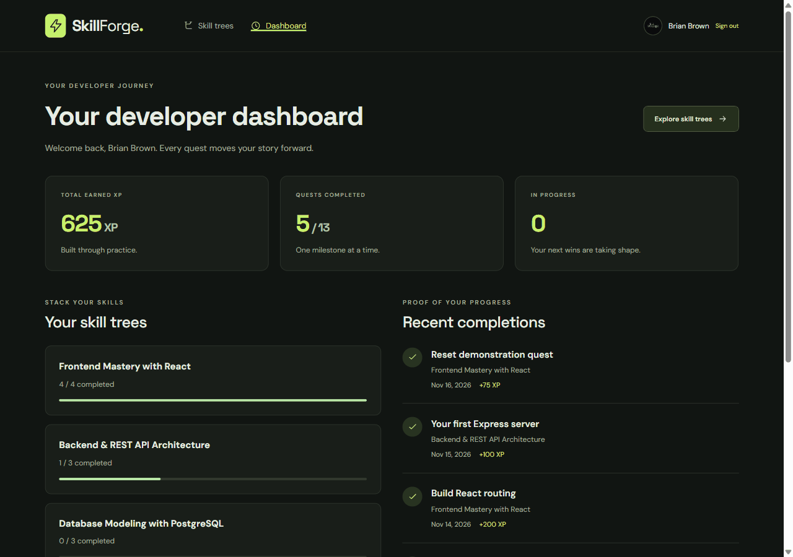
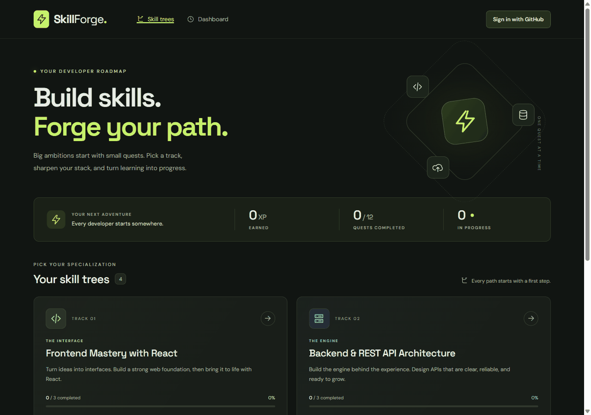

# Milestone 5 Progress Report

## Release status

Live application: [SkillForge](https://skillforge-ckbo.onrender.com/).

The original M5 functionality and evidence were merged in [PR #21](https://github.com/bbdevelops/web103_finalproject/pull/21), [PR #22](https://github.com/bbdevelops/web103_finalproject/pull/22), and [PR #23](https://github.com/bbdevelops/web103_finalproject/pull/23). The teammate's toast implementation was merged in [PR #24](https://github.com/bbdevelops/web103_finalproject/pull/24), with its recordings added afterward. The six original M5 issues are now closed.

The approved rubric follow-up adds three issues. **Current M5 completion: 66.67% (6 closed / 9 total).** Issues #25?#27 remain open until deployment, evidence, and post-merge reconciliation pass. Repository implementation and local cloud verification do not constitute completed deployed evidence.

## Completed issues and implementation locations

- [#13 Developer Dashboard](https://github.com/bbdevelops/web103_finalproject/issues/13) ? protected dashboard, totals, tree progress, latest ten completions and quest links; `client/src/pages/DashboardPage.jsx`, `server/app.js`.
- [#14 Database reset](https://github.com/bbdevelops/web103_finalproject/issues/14) ? authorized transactional reset with preserved identities, roles, sessions and rollback; `server/db/reset.js`, `client/src/components/ResetDatabase.jsx`.
- [#15 Toast notifications](https://github.com/bbdevelops/web103_finalproject/issues/15) ? teammate-contributed reusable feedback, loading/result variants, dismissal, live regions and modal hosts; `client/src/components/Toast.jsx`, `client/src/hooks/useToast.js`, associated callers and styles.
- [#16 Render deployment](https://github.com/bbdevelops/web103_finalproject/issues/16) ? one HTTPS service for React, Express and GitHub sessions; `render.yaml`, `server/index.js`, `server/app.js`, `docs/render-deployment.md`.
- [#19 Quest filtering and sorting](https://github.com/bbdevelops/web103_finalproject/issues/19) ? combined filters and deterministic ordering; `client/src/components/QuestFilters.jsx`, `client/src/pages/TreeDetailPage.jsx`.
- [#20 Original final evidence](https://github.com/bbdevelops/web103_finalproject/issues/20) ? original deployed walkthrough, checklist/reflections and release evidence; README, `milestones/milestone5.md`, M5 GIFs and recording tools.

## Rubric follow-up in progress

- [#25 Quest cover uploads and one-to-one media](https://github.com/bbdevelops/web103_finalproject/issues/25) ? `server/db/media.sql`, `server/db/migrate.js`, `server/media.js`, image routes and `QuestCover`: one optional public image per quest, authorized cloud uploads, normalization, rollback, cleanup and private backups.
- [#26 Button disabling coverage](https://github.com/bbdevelops/web103_finalproject/issues/26) ? `ActionButton`, submission guards and audit scripts. **33/35 declarations (94.29%)** are guarded; the browser suite observed **406/426 visible button instances (95.31%)** across 50 interaction states. Both denominators include the two original toast controls, whose implementation is unchanged.
- [#27 Final regression and evidence reconciliation](https://github.com/bbdevelops/web103_finalproject/issues/27) ? updated suites, pixel comparisons, cloud check, runbooks and checkpointed recording tools. Real deployed cover/click GIFs and the refreshed complete walkthrough remain pending.

## Features and recorded evidence

- ? Developer Progression & XP Tracker ? README Feature 3.
- ? Database Default State Reset ? README Feature 6.
- ? Action Feedback & Toast Notification System ? README Feature 7, contributed by the team.
- ? Quest Filtering & Sorting ? README Feature 8.

The existing walkthrough predates quest covers and extended click guards. Their new evidence will be added after production checks. Historical M3/M4 recordings are preserved.

## Verified behavior

Current verified checks: **46 passing API/database tests**, **22 isolated browser scenarios**, lint, build, built routing smoke checks, zero production dependency audit vulnerabilities, and real Cloudinary upload/CDN delivery/replacement/removal with test assets cleaned up in a disposable schema. The final deployed release checks and new recordings remain pending.

Toast source, hooks, helpers, and the shared stylesheet remain unchanged from the teammate's merged commit `6c7b64c`. Desktop, mobile, and modal toast captures are **pixel-identical** to that baseline. The existing feedback variants, icons, timing, animations and placement are preserved.

New API coverage exercises additive migrations, actual one-to-one constraints, upload permissions/content validation, metadata stripping, replacement rollback, cleanup retries, reset rollback/concurrency, and schema-scoped catalog locks. The original empty-catalog fixture now includes the image table in its explicit truncate list.

## Private configuration and backups

The private Cloudinary values are server-only. Real cloud checks have passed locally; the matching Render values and deployed feature evidence remain a manual checkpoint. See [quest-cover setup](../docs/quest-covers.md).

A fresh PostgreSQL 18 archive was verified before deployment preparation. The backup command now also archives referenced image bytes and hashes before global reset. Database dumps, media archives, credentials, profiles and session cookies remain under ignored local paths. A recorded production reset still requires owner confirmation.

## Rubric and milestone totals

The baseline is implemented. Seven custom features and five stretch features are verified in the current live release, including toasts. The one-to-one relationship, cloud image uploads, and the separate 75%-of-buttons item remain unchecked until their deployed follow-up evidence passes.

M1: 100% (1/1); M2: 100% (1/1); M3: 100% (4/4); M4: 100% (6/6); **M5: 66.67% (6/9)**. New issues stay In Progress until acceptance passes and the board is reconciled after PR merges.
