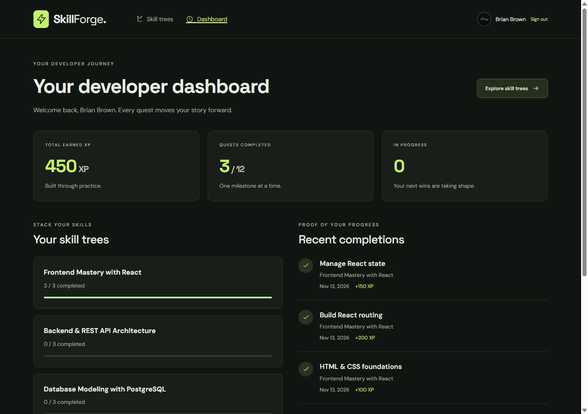
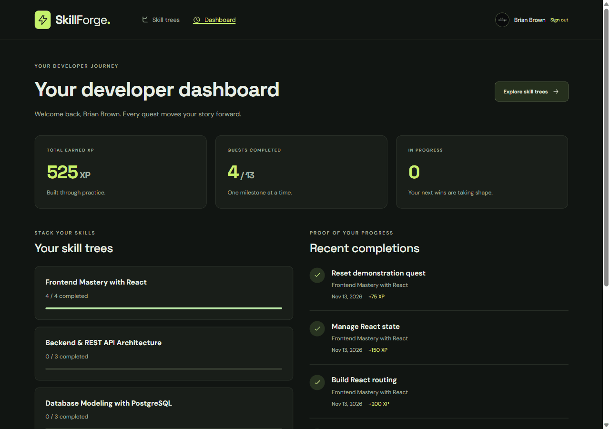
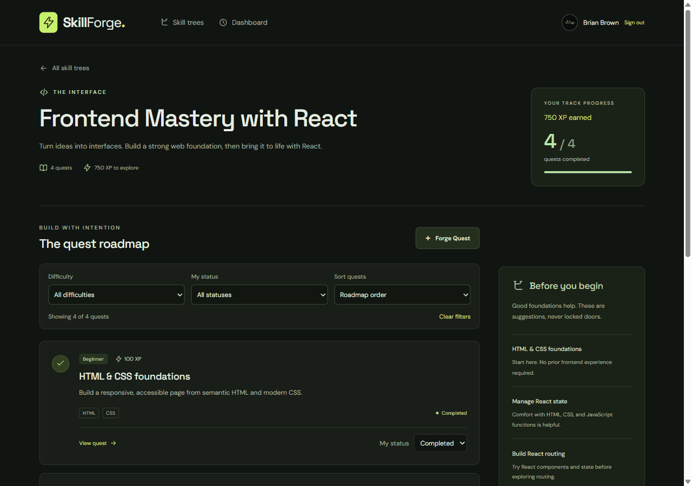
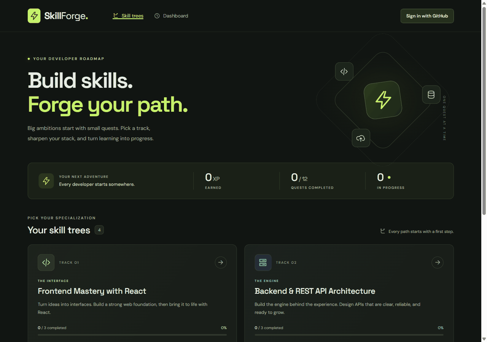

# Milestone 5 Progress Report

## Release

Live application: [SkillForge](https://skillforge-ckbo.onrender.com/).

The functional release was merged in [PR #21](https://github.com/bbdevelops/web103_finalproject/pull/21); [PR #22](https://github.com/bbdevelops/web103_finalproject/pull/22) fixed canonical origin handling and supplied the deployed recording tools. [PR #23](https://github.com/bbdevelops/web103_finalproject/pull/23) adds the recorded walkthroughs and completed submission documents to main.

Completion percentage for Milestone 5 - Unit 9: **83.33% (5 closed / 6 total)**. Dashboard #13, reset #14, deployment #16, filtering #19, and final evidence #20 are complete with checked acceptance criteria and Done board states. Toast issue #15 remains open and teammate-owned; it was not moved out of M5 or claimed complete here.

## Completed issues and implementation locations

- [#13 Developer Dashboard](https://github.com/bbdevelops/web103_finalproject/issues/13) — `client/src/pages/DashboardPage.jsx`, `server/app.js`: protected access, private totals, per-tree progress, latest ten completions, repository links, and quest deep links.
- [#14 Database reset](https://github.com/bbdevelops/web103_finalproject/issues/14) — `server/db/reset.js`, `server/app.js`, `client/src/components/ResetDatabase.jsx`: authorized transaction, confirmation, rollback, and preserved identities/roles/sessions.
- [#16 Render deployment](https://github.com/bbdevelops/web103_finalproject/issues/16) — `render.yaml`, `server/index.js`, `server/app.js`, `server/auth.js`, `server/config.js`, `docs/render-deployment.md`: one HTTPS origin for React, Express, and GitHub sessions, existing database reused, production routing and canonical origin handling.
- [#19 Quest filtering and sorting](https://github.com/bbdevelops/web103_finalproject/issues/19) — `client/src/components/QuestFilters.jsx`, `client/src/pages/TreeDetailPage.jsx`: difficulty/status filters, deterministic roadmap/XP/title ordering, matching counts, and clear/empty states.
- [#20 Final rubric and evidence](https://github.com/bbdevelops/web103_finalproject/issues/20) — `milestones/milestone5.md`, this report, README, `docs/gifs/m5-*.gif`, verification/recording scripts: completed checklist/reflections, deployment evidence, three feature GIFs, and full walkthrough.

## Features completed this unit

- ✅ Developer Progression & XP Tracker — README Feature 3; personal dashboard, recent completion history, and persisted progress.
- ✅ Database Default State Reset — README Feature 6; admin-only global restoration with preserved accounts and sessions.
- ✅ Quest Filtering & Sorting — README Feature 8; combined filters and deterministic sort options without changing full-tree totals.

## Complete deployed walkthrough

The walkthrough uses the real deployed application, GitHub authentication, and PostgreSQL-backed responses. It shows public/read-only content, protected sign-in, invalid input rejected by the server, CRUD, accessible panes, notes/repository links, completion/XP, dashboard history and deep links, filters, reset, and logout. Controlled browser latency makes genuine loading and disabled pending states readable; API responses are not mocked. Historical M3/M4 evidence is preserved.

## Verification

- `npm test`: **32 passing** PostgreSQL/API integration tests in disposable schemas; eight M5 cases include recent-history ordering/isolation, reset authorization/repeatability/rollback, preserved identities/roles/sessions, private admin provisioning, trailing-slash origin normalization, foreign-origin rejection, and production cookie flags.
- `npm run test:browser`: **20 passing** Chrome checks against an isolated schema, with only the external OAuth provider simulated; no uncaught browser errors.
- `npm run lint`, `npm run build`, and `npm run test:production`: pass. Built routing smoke checks include browser deep links/assets, JSON API/auth 404s, missing files, and health.
- `npm run test:deployed -- https://skillforge-ckbo.onrender.com`: public database health, catalog API, React deep links/assets, private guest restrictions, and missing-route behavior pass.
- `npm run test:oauth`: real HTTPS GitHub sign-in, return to the original tree, refresh persistence, logout, and protected-dashboard reauthentication pass.
- Live canonical-origin logout returns 204. A trailing slash in CLIENT_ORIGIN is normalized while foreign origins and ports remain rejected.
- The recording verifies real admin access and owner-confirmed reset. Default catalog and zero owner XP are checked after reset; the admin session remains authenticated before final logout.

## Backup and scope

A fresh PostgreSQL 18 custom backup was created and checked before global reset. The owner confirmed Reset to defaults in Chrome; the recorder did not submit that confirmation automatically. The private archive, metadata, browser profile, and session cookies remain under ignored `.artifacts/m5/` and are excluded from source control. Deployment itself does not run the destructive development seed.

Only approved GitHub identity `bbdevelops` was provisioned as a real admin. Ordinary users remain developers. Toast issue [#15](https://github.com/bbdevelops/web103_finalproject/issues/15) is teammate-owned; no toast implementation or credit is claimed here. One-to-one relationships, cloud uploads, and the separate 75%-of-buttons requirement remain unchecked.

## Rubric evidence

The authoritative implemented-feature checklist, five reflections, and complete walkthrough are in [milestone5.md](milestone5.md).

| Category | Evidence |
| --- | --- |
| React/Express and component hierarchy | Client/server workspaces; page containers, reusable panes, dashboard and filters |
| Actual PostgreSQL relationships | `skill_trees` → `quests`; `users` ↔ `quests` through `user_quests`, with custom progress fields |
| RESTful API and validated writes | Quest GET/POST/PATCH/DELETE; negative validation demonstration and database/API tests |
| Reset and custom action route | `POST /api/reset`, isolated rollback/authorization tests, owner-confirmed deployed GIF |
| Redirection, dynamic routes, same-page changes | OAuth return paths, React Router tree/dashboard routes, quest panes and status/XP controls |
| Render deployment | Working public HTTPS URL, live checks, and deployed walkthrough |
| Additional custom features | Graceful errors, modal panes, custom join fields, reset action, filtering/sorting, generated completion snapshots/timestamps, and validation |
| Included stretch features | Protected dashboard, dynamically restricted options, loading spinners, disabled pending controls |

## GitHub status

M1: 100% (1/1); M2: 100% (1/1); M3: 100% (4/4); M4: 100% (6/6); M5: 83.33% (5/6). The [project board](https://github.com/users/bbdevelops/projects/2) and issue criteria are reconciled after the final evidence merge, with #15 remaining open.
