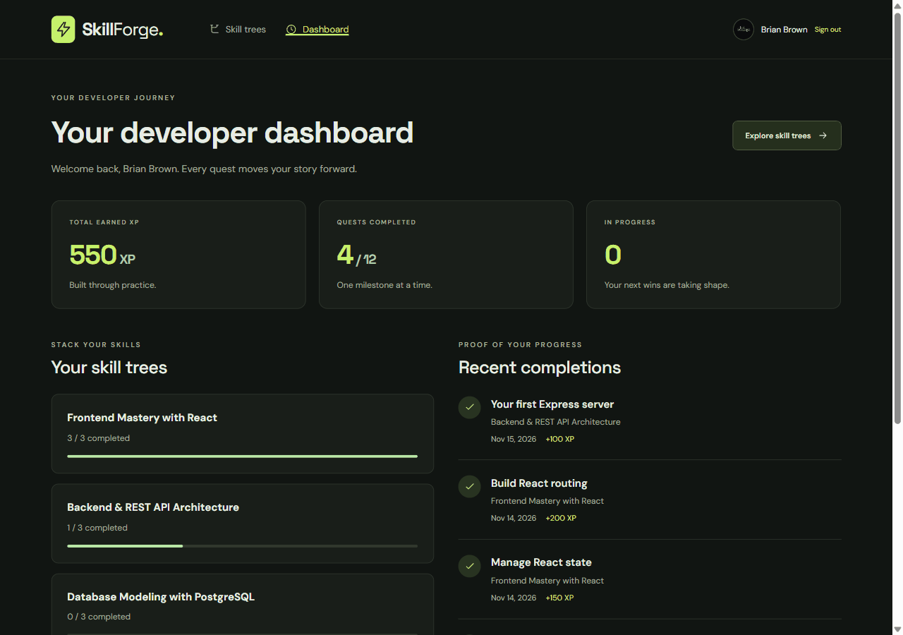
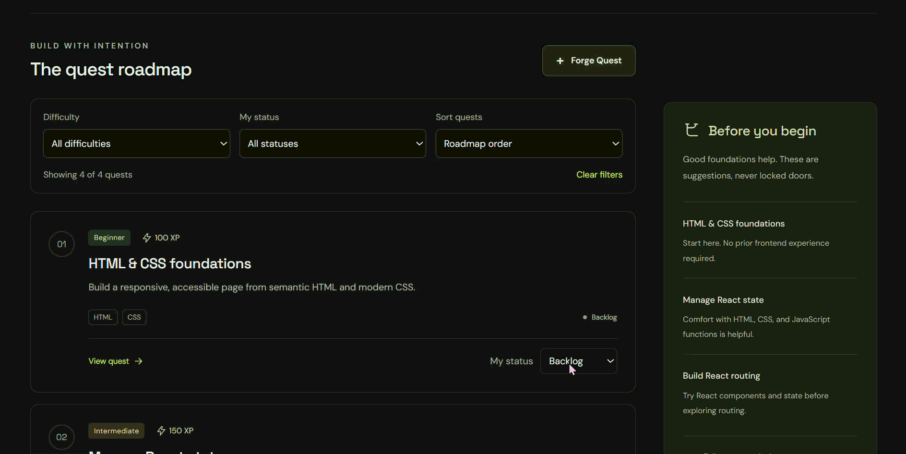
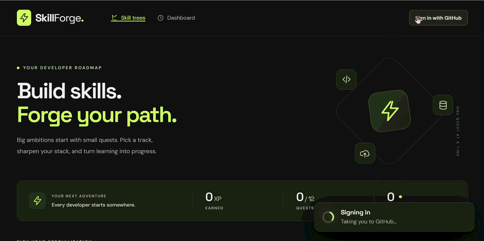
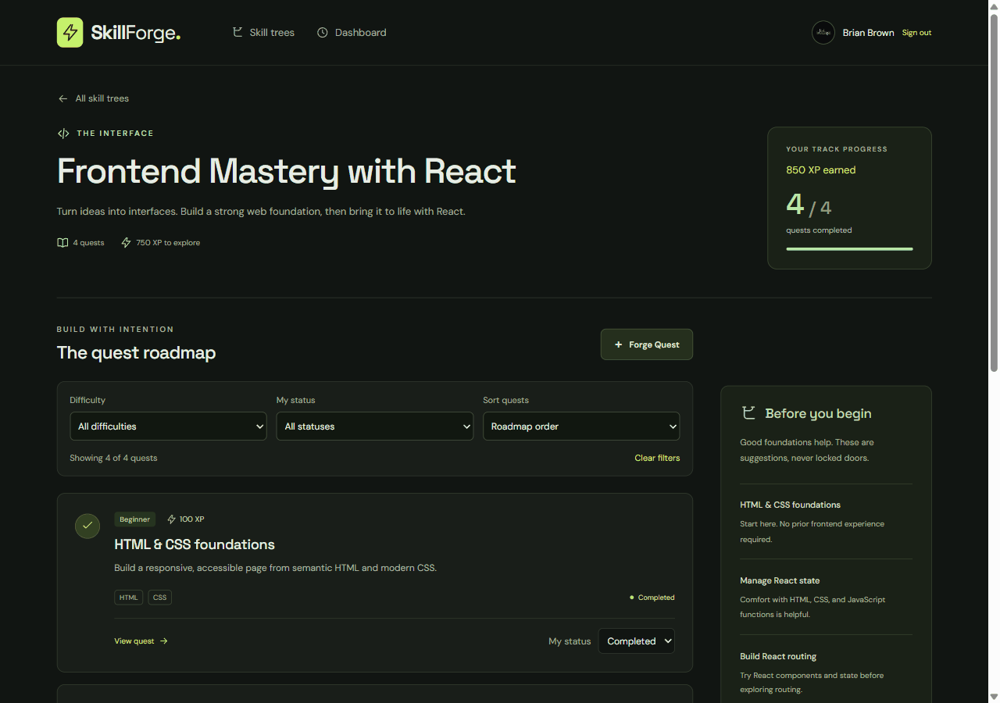
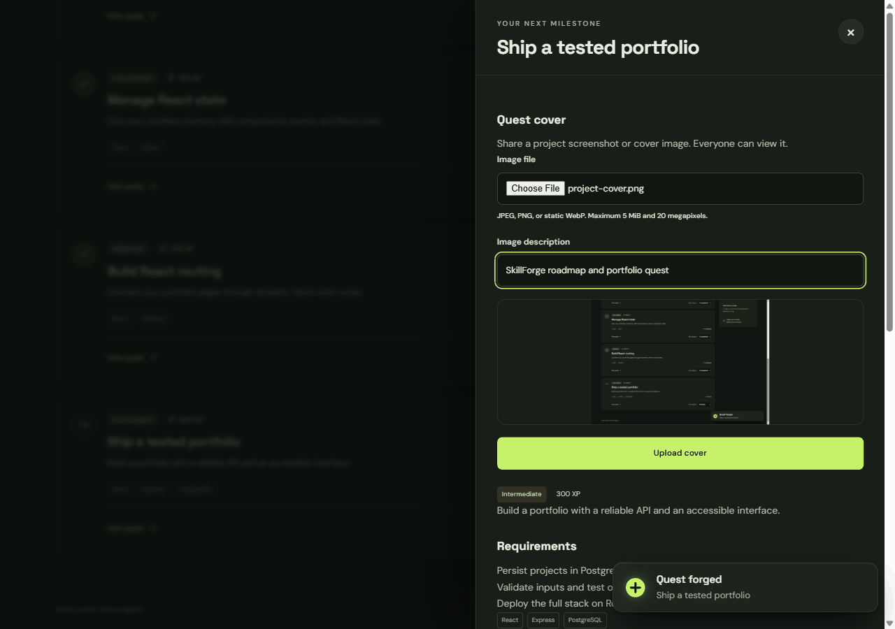
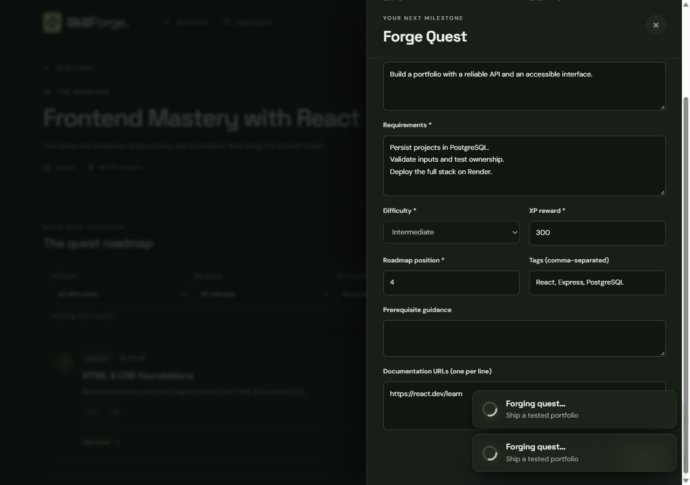

# Milestone 5 Progress Report

## Final release

Live application: [SkillForge](https://skillforge-ckbo.onrender.com/).

**Milestone 5 completion: 100% (9 closed / 9 total).** The original six issues and approved rubric follow-up issues #25-#27 are complete, with checked acceptance criteria and Done board states after release reconciliation. The teammate's toast contribution remains intact.

Original M5 delivery: [PR #21](https://github.com/bbdevelops/web103_finalproject/pull/21), [PR #22](https://github.com/bbdevelops/web103_finalproject/pull/22), and [PR #23](https://github.com/bbdevelops/web103_finalproject/pull/23). Toasts: [PR #24](https://github.com/bbdevelops/web103_finalproject/pull/24). Cloud covers, one-to-one media, click guards, and preservation checks: [PR #28](https://github.com/bbdevelops/web103_finalproject/pull/28). Final evidence: [PR #29](https://github.com/bbdevelops/web103_finalproject/pull/29).

## Completed issues and implementation locations

- [#13 Developer Dashboard](https://github.com/bbdevelops/web103_finalproject/issues/13) - protected totals, tree progress, recent completions and quest links; `client/src/pages/DashboardPage.jsx`, `server/app.js`.
- [#14 Database reset](https://github.com/bbdevelops/web103_finalproject/issues/14) - authorized transactional reset and preserved identities/roles/sessions; `server/db/reset.js`, `client/src/components/ResetDatabase.jsx`.
- [#15 Toast notifications](https://github.com/bbdevelops/web103_finalproject/issues/15) - teammate-contributed feedback, loading/result variants, live regions, dismissal and modal hosts; `client/src/components/Toast.jsx`, `client/src/hooks/useToast.js` and associated helpers/styles.
- [#16 Render deployment](https://github.com/bbdevelops/web103_finalproject/issues/16) - shared HTTPS origin, production cookies, assets and deep links; `render.yaml`, `server/index.js`, `server/app.js`, `docs/render-deployment.md`.
- [#19 Quest filtering and sorting](https://github.com/bbdevelops/web103_finalproject/issues/19) - combined personal/difficulty filters and deterministic sorting; `client/src/components/QuestFilters.jsx`, `client/src/pages/TreeDetailPage.jsx`.
- [#20 Original final evidence](https://github.com/bbdevelops/web103_finalproject/issues/20) - original checklist, reflections, deployed walkthrough and supporting release evidence; README, `milestones/milestone5.md`, recording tools and M5 GIFs.
- [#25 Quest cover uploads and one-to-one media](https://github.com/bbdevelops/web103_finalproject/issues/25) - `server/db/media.sql`, `server/db/migrate.js`, `server/media.js`, `server/routes/images.js`, `client/src/components/QuestCover.jsx`: actual one-to-one constraints, authorized uploads, normalization, rollback, cleanup, backups and deployed evidence.
- [#26 Button disabling coverage](https://github.com/bbdevelops/web103_finalproject/issues/26) - `client/src/components/ActionButton.jsx`, `client/src/hooks/useGuardedSubmit.js`, `scripts/verify-buttons.mjs`, browser checks: immediate click locks, pending submissions, native validation, recovery and focus restoration.
- [#27 Final regression and evidence reconciliation](https://github.com/bbdevelops/web103_finalproject/issues/27) - `docs/m5-verification.md`, this report, README, milestone checklist/reflections, verification tools and refreshed GIFs: production/provider checks and reconciled GitHub status.

## Completed features and GIF evidence

### ✅ Developer Progression & XP Tracker - README Feature 3

Private dashboard totals, track progress, recent completions, repository links and quest deep links.

### ✅ Database Default State Reset - README Feature 6

Admin-only global restoration with preserved accounts, roles and sessions; cloud covers are removed and queued remote cleanup completes.

### ✅ Action Feedback & Toast Notification System - README Feature 7

Teammate-contributed feedback and loading/result transitions are preserved, including the original recordings.

### ✅ Quest Filtering & Sorting - README Feature 8

Combined difficulty/status filters, clear/empty states and deterministic ordering preserve full-tree totals.

### ✅ Quest Covers & Project Screenshots - README Feature 9

Real local-file uploads to Cloudinary, public viewing, persistence, replacement and removal. PostgreSQL enforces one cover per quest with a primary-key/foreign-key relationship.

### ✅ Duplicate-Click Guards - README Feature 10

**33/35 declarations (94.29%)** use click guards. The browser suite observed **406/426 visible button instances (95.31%)** across 50 interaction states. Both denominators include the two original toast controls, which retain their existing implementation.

## Complete deployed walkthrough

The walkthrough uses real GitHub authentication, PostgreSQL-backed responses and Cloudinary uploads. It demonstrates public/owner restrictions, rejected input, CRUD, accessible panes, personal progress and XP, dashboard history and deep links, filtering, cloud covers, disabled controls, toast feedback, owner-confirmed global reset and logout. Controlled network latency exposes genuine loading/pending states; API responses are not mocked.

Historical M3/M4 recordings and teammate toast GIFs are unchanged. The [original M5 walkthrough](../docs/gifs/archive/m5-2026-11-14/m5-final-walkthrough.gif) and its three original feature recordings are archived.

## Verification

- `npm test`: **46 passing** API/PostgreSQL tests in disposable schemas. Media cases cover additive/repeatable migration, actual uniqueness/foreign keys, permissions/content validation, metadata stripping, rollback compensation, retries, reset concurrency and schema-scoped locks. An additional focused provider-failure check passed.
- `npm run test:browser`: **22 passing** scenarios, including preserved failed image selections, duplicate-upload prevention, replacement/removal, public viewing, mobile layout, keyboard/focus behavior and button coverage; no uncaught browser errors.
- Lint, production build, built routing smoke checks, and button inventory pass. Production dependency audit reports zero vulnerabilities.
- `npm run test:toast-visuals`: desktop, mobile and modal toast captures are **pixel-identical** to the teammate's merged implementation at `6c7b64c`. Toast source, hooks/helpers and shared CSS remain unchanged.
- `npm run test:cloudinary`: actual upload, CDN delivery, replacement, public reads, removal and cleanup pass with disposable assets and an isolated schema.
- Deployed smoke checks verify health, catalog, routes/assets, image response contract, guarded client bundle, guest restrictions and JSON/asset 404 behavior.
- Real GitHub sign-in, original-page return, refresh persistence, logout and protected-dashboard reauthentication pass on HTTPS.
- A read-only deployed schema check verifies `quest_images.quest_id` is both primary key and cascading foreign key to `quests`.
- The owner-confirmed recorded reset restores four trees/twelve quests and zero owner XP while preserving the admin session. Follow-up checks verify zero cover references, an empty cleanup queue and removal of the real cloud sample.

Full details: [M5 verification](../docs/m5-verification.md). Setup/operations: [quest covers](../docs/quest-covers.md) and [Render runbook](../docs/render-deployment.md).

## Private configuration and backup

Cloudinary credentials are configured privately in local `.env` and Render. The image API keeps credentials and provider identifiers server-controlled. The additive production migration preserves existing identities, roles, sessions, catalog content and progress; deployment never runs the destructive development seed.

A PostgreSQL 18 archive and all referenced image bytes were privately saved and checked by SHA-256 before the owner clicked Reset to defaults. The cloud image backup remains available after remote cleanup. SQL references alone cannot restore deleted cloud bytes. Private archives, metadata, profiles, cookies and detailed check artifacts remain ignored and outside source control.

## Rubric and milestone totals

All **10 baseline**, **8 custom**, and **7 stretch** feature categories are implemented and evidenced. The authoritative checklist and five factual reflections are in [milestone5.md](milestone5.md). The one-to-one, cloud-upload and separate 75%-button items are now checked after their deployed verification.

M1: 100% (1/1); M2: 100% (1/1); M3: 100% (4/4); M4: 100% (6/6); **M5: 100% (9/9)**. The [project board](https://github.com/users/bbdevelops/projects/2) is reconciled after the final evidence merge.
