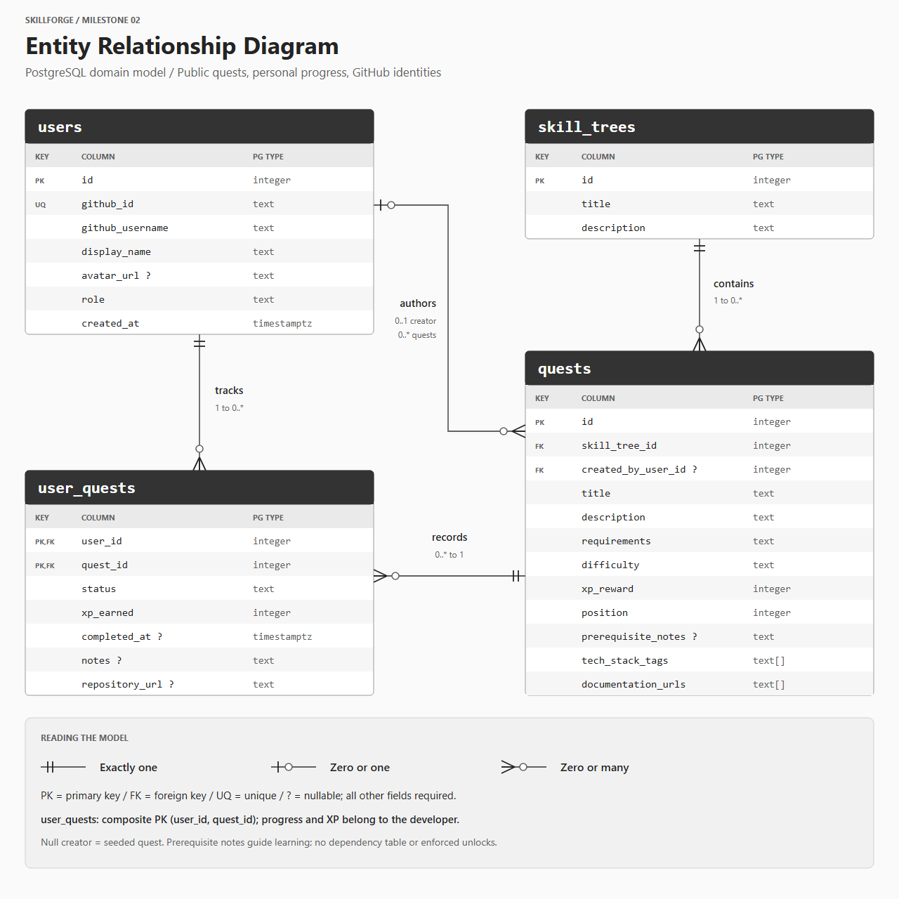

# SkillForge Entity Relationship Diagram

This proposed PostgreSQL domain model supports the README's catalog, quest CRUD, GitHub identities, and personal progress. It describes the planned database; this milestone does not create tables or migrations.

## List of Tables

| Table | Purpose |
|---|---|
| `users` | GitHub identity, display information, and authorization role. |
| `skill_trees` | Curated developer tracks that group quests. |
| `quests` | Public roadmap milestones and custom coding challenges. |
| `user_quests` | Personal status, earned XP, completion time, notes, and repository link. |

## Entity Relationship Diagram

[Editable SVG](assets/entity-relationship-diagram.svg)

Symbols mean **exactly one** (two bars), **zero or one** (circle and bar), and **zero or many** (circle and fork). `PK` = primary key; `FK` = foreign key; `UQ` = unique. A `?` suffix means nullable; all other fields are required.

| Relationship | Cardinality and meaning |
|---|---|
| `skill_trees` → `quests` | A tree contains zero or many quests. Every quest belongs to exactly one tree. |
| `users` → `quests` (authorship) | A user authors zero or many quests. A quest has zero or one creator; null identifies seeded content. |
| `users` → `user_quests` | A user has zero or many progress records. Each record belongs to exactly one user. |
| `quests` → `user_quests` | A quest has zero or many progress records. Each record refers to exactly one quest. |

The last two implement **users ↔ quests many-to-many**. Authorship and personal progress are independent: a quest's creator can differ from the developers tracking it.

## Field Definitions

### `users`

| Column | PostgreSQL type | Nullable | Key / rule | Purpose |
|---|---|---|---|---|
| `id` | `integer` | No | PK; generated identity | Internal developer identifier. |
| `github_id` | `text` | No | UNIQUE | Stable identity; username changes do not create another account. |
| `github_username` | `text` | No | | Current GitHub handle. |
| `display_name` | `text` | No | | App display name; fall back to GitHub username. |
| `avatar_url` | `text` | Yes | | Optional GitHub profile image URL. |
| `role` | `text` | No | Default `developer`; CHECK in (`developer`, `admin`) | Owner/admin authorization; never assigned by a public account form. |
| `created_at` | `timestamptz` | No | Default `now()` | Account creation time. |

GitHub OAuth is the selected account mechanism. Passwords and OAuth access tokens are not stored in this domain schema. Session storage is authentication infrastructure to be specified when authentication is implemented; this domain ERD does not claim that infrastructure tables will never be needed.

### `skill_trees`

| Column | PostgreSQL type | Nullable | Key / rule | Purpose |
|---|---|---|---|---|
| `id` | `integer` | No | PK; generated identity | Dynamic `/trees/:id` identifier. |
| `title` | `text` | No | Nonblank | Developer-track name. |
| `description` | `text` | No | Nonblank | Track purpose and scope. |

Seed the four tracks shown in the wireframes: React frontend, backend/REST APIs, PostgreSQL modeling, and DevOps/deployment. Tree creation/deletion has no developer-facing interface in the current design.

### `quests`

| Column | PostgreSQL type | Nullable | Key / rule | Purpose |
|---|---|---|---|---|
| `id` | `integer` | No | PK; generated identity | Shared quest identifier. |
| `skill_tree_id` | `integer` | No | FK → `skill_trees.id` | Each quest belongs to one tree. |
| `created_by_user_id` | `integer` | Yes | FK → `users.id` | Custom creator; null identifies seeded content. |
| `title` | `text` | No | Nonblank | Actionable title. |
| `description` | `text` | No | Nonblank | Context and instructions. |
| `requirements` | `text` | No | Nonblank | Deliverables and acceptance criteria. |
| `difficulty` | `text` | No | CHECK in (`beginner`, `intermediate`, `advanced`) | Display as Beginner, Intermediate, or Advanced. |
| `xp_reward` | `integer` | No | CHECK `>= 0` | Reward copied into progress on completion. |
| `position` | `integer` | No | CHECK `>= 0` | Advisory order within a tree; ties sort by quest ID. |
| `prerequisite_notes` | `text` | Yes | | Informational guidance. |
| `tech_stack_tags` | `text[]` | No | Default empty array | Lightweight tags. |
| `documentation_urls` | `text[]` | No | Default empty array | Reference links in the details pane. |

Prerequisites never lock a quest, so no dependency table or prerequisite foreign key is needed. Future API validation rejects blank required text, fractional/negative integer values, invalid enums, and non-HTTP(S) links. Arrays contain trimmed, nonblank entries.

### `user_quests`

| Column | PostgreSQL type | Nullable | Key / rule | Purpose |
|---|---|---|---|---|
| `user_id` | `integer` | No | Composite PK; FK → `users.id` | Developer whose progress is recorded. |
| `quest_id` | `integer` | No | Composite PK; FK → `quests.id` | Quest being tracked. |
| `status` | `text` | No | Default `backlog`; CHECK in (`backlog`, `in_progress`, `completed`) | Personal status, not shared content. |
| `xp_earned` | `integer` | No | Default `0`; CHECK `>= 0` | Completion-time reward snapshot. |
| `completed_at` | `timestamptz` | Yes | Required exactly when completed | Completion time. |
| `notes` | `text` | Yes | | Personal implementation notes. |
| `repository_url` | `text` | Yes | | Personal HTTP(S) repository/project link. |

Composite PK `(user_id, quest_id)` prevents duplicate progress and awards for a developer/quest pair. Status, earned XP, completion time, and notes are custom join-table attributes, satisfying the planned custom feature.

## Integrity, Authorization, and Progress Rules

- Missing progress appears as Backlog with zero XP. Create/update one row when a developer saves status, notes, or a repository link; do not populate every user/quest combination.
- A transition to Completed atomically snapshots the current reward and server completion time. Repeating Completed preserves both. Reopening clears earned XP and completion time while preserving notes and the repository URL.
- Enforce a check equivalent to `(status = 'completed' AND completed_at IS NOT NULL) OR (status <> 'completed' AND completed_at IS NULL AND xp_earned = 0)`. Completed quests may award zero XP.
- Reward edits do not change saved completion awards. Recompletion after reopening uses the reward current at that new completion.
- Derive total XP from the active user's `SUM(xp_earned)`. Completed counts use `completed`; active counts use `in_progress`. Tree completion divides completed quests by all current quests in the tree. Empty trees show zero completed and no percentage.
- Reads are public. Creation assigns the session user as owner; progress writes use only that user. Creators/admins may edit/delete custom quests; only admins manage seeded content. Enforce authorization server-side.
- Restrict deletion of referenced trees and authors. Do not set deleted authors to null, which would misclassify custom quests as seeded. Quest deletion cascades to its progress. User deletion cascades to personal progress only after authored quests are explicitly handled. Account deletion is outside the current UI.
- Global reset requires admin authorization and confirmation. Transactionally replace quests, trees, and progress with default catalog/starter progress while preserving GitHub identities and roles. Resolve starter progress against the demo identity instead of assuming a live user's ID. Repeated reset produces the same default domain state.
- Derive XP totals and percentages rather than storing balances in `users`. Additional badge/level mechanics are not introduced by this milestone.

## Consistent Example Records

These match the [wireframes](wireframes.md). IDs illustrate relationships; no seed script is implemented.

| Example record | Values |
|---|---|
| Developer | User 1, Alex Chen, role `developer`. |
| React track | Tree 1, three quests. |
| Quest 101 | HTML & CSS foundations; creator null; beginner; reward 100; position 1. |
| Quest 102 | Manage React state; creator null; intermediate; reward 150; position 2. |
| Quest 103 | Build React routing; creator 1; advanced; reward 200; position 3. |
| Progress `(1, 101)` | `completed`, XP 100, nonnull completion time. |
| Progress `(1, 102)` | `in_progress`, XP 0, null completion time. |
| Progress `(1, 103)` | `backlog`, XP 0, null completion time; personal notes may exist. |
| Remaining catalog | Nine unstarted quests in the other three trees; no Alex progress rows. |

Result: **100 XP**, **1 / 12 completed**, **1 in progress**, and **1 / 3 completed in React**. Two users can track the same quest independently because their composite keys differ.

## Asset Sources

The PNG and editable SVG are stored under `planning/assets/`. Use the browser-export command in [Wireframes](wireframes.md#asset-sources-and-regeneration) to regenerate them.
