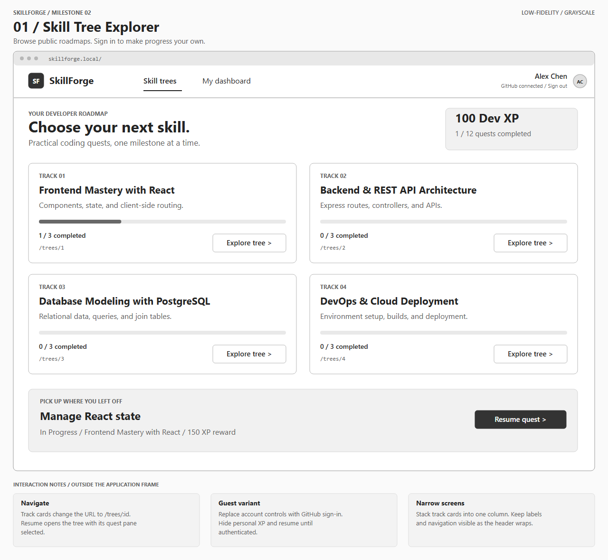
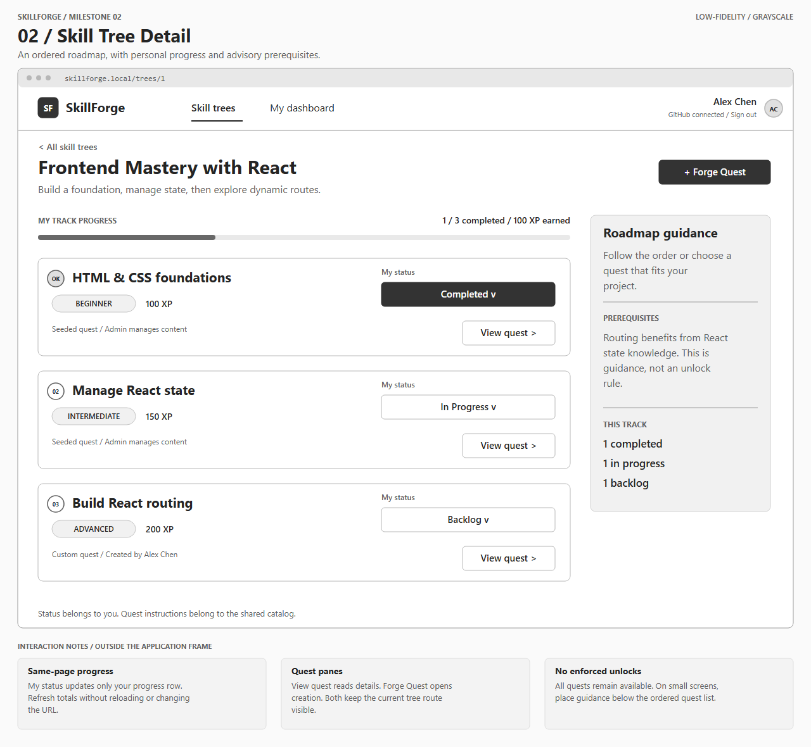
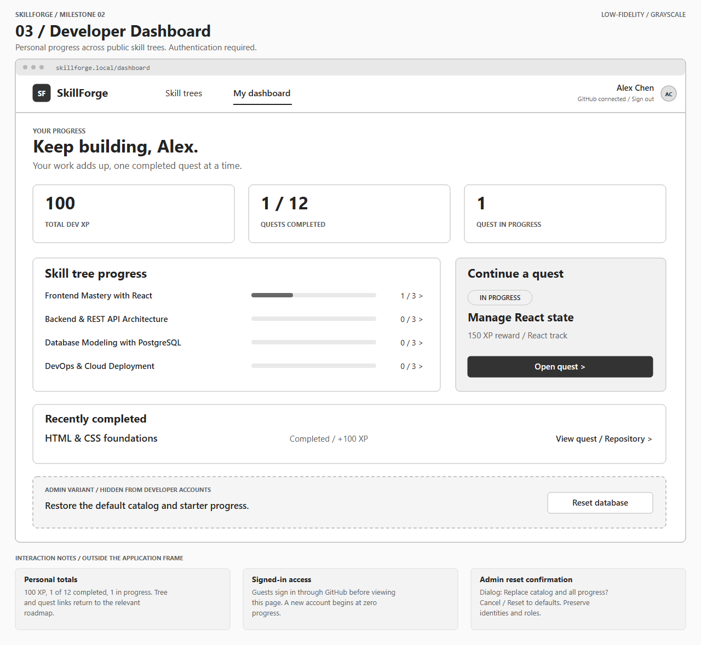
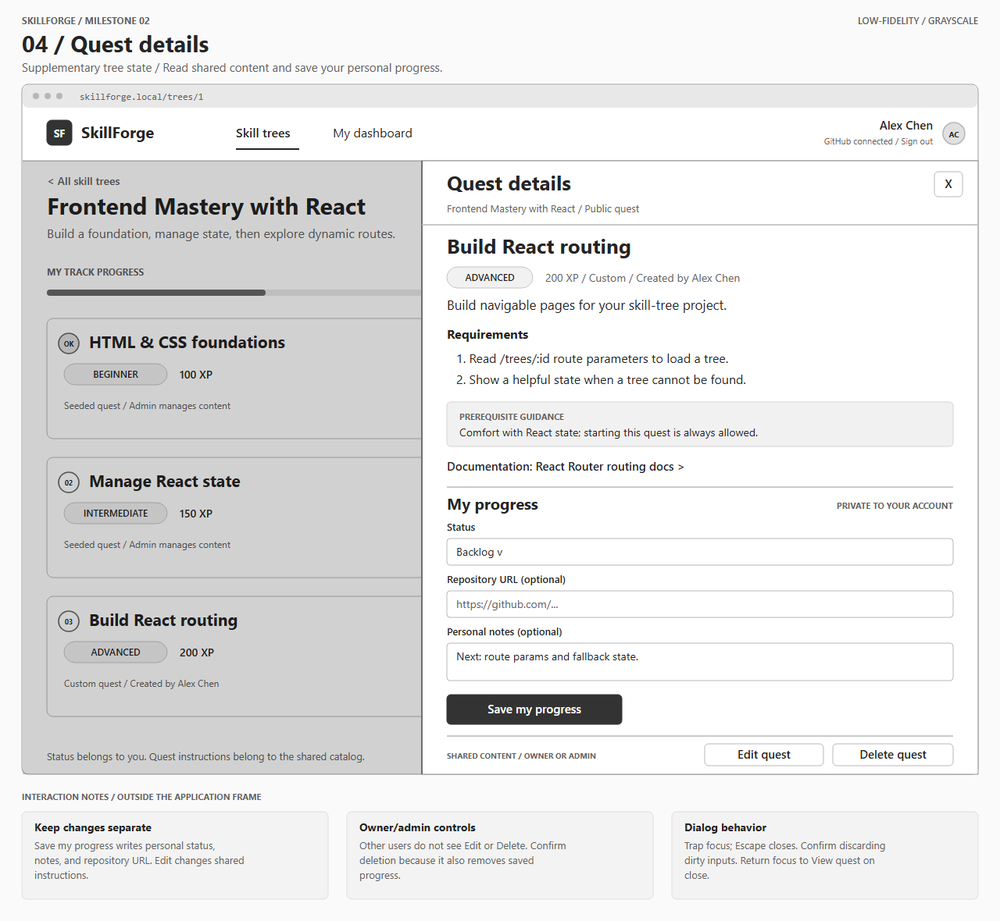
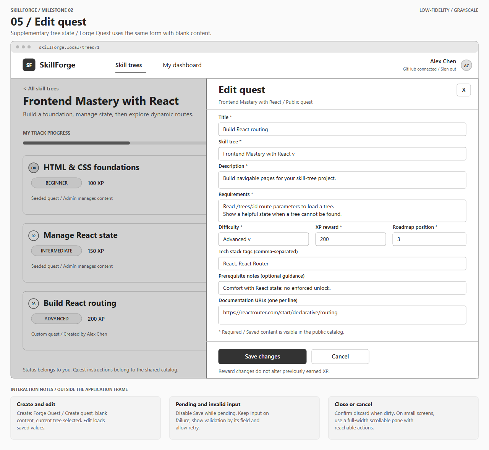

# SkillForge Wireframes

These low-fidelity grayscale wireframes describe the planned React application for aspiring and junior web developers. They are design artifacts, not screenshots of implemented features.

## List of Pages

| Wireframed | Page | Planned route | Access |
|---|---|---|---|
| ⭐ | Skill Tree Explorer | `/` | Public; personal progress appears after sign-in. |
| ⭐ | Skill Tree Detail | `/trees/:id` | Public; mutations require sign-in. |
| ⭐ | Developer Dashboard | `/dashboard` | Signed-in developers only. |

The two quest-pane images below are additional states of Skill Tree Detail, not additional pages. GitHub OAuth provides sign-in without a separate application login page.

## Wireframe 1: Skill Tree Explorer



[Editable SVG](assets/skill-tree-explorer.svg)

- Display Frontend Mastery with React, Backend & REST API Architecture, Database Modeling with PostgreSQL, and DevOps & Cloud Deployment.
- Each card opens its dynamic `/trees/:id` page. The dashboard link opens `/dashboard`; the SkillForge logo returns to `/`.
- Signed-in developers see personal completion counts and a resume action. Guests see the same public catalog, **Sign in with GitHub**, and an invitation to sign in instead of personal statistics.

## Wireframe 2: Skill Tree Detail



[Editable SVG](assets/skill-tree-detail.svg)

- Show ordered quests, difficulty, XP rewards, and prerequisite guidance. Prerequisites never prevent starting or completing a quest.
- **View quest** opens the details pane without changing the route. **Forge Quest** opens creation with the current tree preselected.
- **My status** updates only the active developer's `user_quests` record without reloading the page. Successful changes refresh personal XP and completion counts.
- Guests can read quest content; status controls and Forge Quest prompt GitHub sign-in. After authentication, return to the original tree without automatically submitting the intended action.

## Wireframe 3: Developer Dashboard



[Editable SVG](assets/developer-dashboard.svg)

- Summarize earned XP, completed quests, quests in progress, progress per tree, and recent completions with saved repository links.
- A tree row opens `/trees/:id`. A quest link opens its tree and selected details pane; a repository link opens the saved external URL.
- Signed-out visitors to `/dashboard` start GitHub sign-in and return after success. Failed or cancelled sign-in leaves a retry action and does not expose personal data.
- The dashed reset area illustrates an **admin-only variant**, not a control visible to the example developer. **Reset database** opens a confirmation naming the global effect: replace catalog and progress with defaults. **Cancel** preserves data; **Reset to defaults** invokes the planned `POST /api/reset` and refreshes displayed data. Preserve GitHub identities and roles during reset. The server must enforce admin access independently of button visibility.

## Supplementary State: Quest Details Pane



[Editable SVG](assets/quest-details-pane.svg)

- Keep the tree visible behind a dimmed overlay and leave `/trees/:id` unchanged.
- **Save my progress** saves status, notes, and repository URL for the current user. These fields never change shared quest content.
- Show **Edit quest** and **Delete quest** only to the creator or an admin. Admins also manage seeded quests, whose creator is null. Other developers can read the public quest and track their own progress.
- **Delete quest** opens a confirmation naming the quest and explaining that its saved progress for all users will also be removed. Cancel preserves everything. Confirm deletes the shared quest, closes the pane, and refreshes affected counts and XP totals.

## Supplementary State: Create / Edit Quest Pane



[Editable SVG](assets/quest-forge-pane.svg)

- Reuse this form for creation and editing. Creation shows **Forge Quest** / **Create quest**, starts with empty content, and preselects the tree. Editing loads existing values and shows **Edit quest** / **Save changes**.
- Require title, description, requirements, tree, difficulty, nonnegative integer XP reward, and nonnegative integer roadmap position. Tags, prerequisite notes, and documentation URLs are optional. Equal positions are valid; order ties by quest ID.
- Accept comma-separated tags and one documentation URL per line; trim entries and omit blanks when constructing PostgreSQL arrays. Validate supplied documentation and repository links as HTTP(S) URLs.
- Assign creation ownership from the signed-in account. Saving shared content updates the public catalog; it does not update personal notes or earned XP.
- **Cancel**, close, Escape, or backdrop click closes the pane. Confirm discard when inputs are dirty. Successful save closes the pane and refreshes the tree; moving a quest to another tree removes it from the current tree.

## Interaction, Access, and Responsive Notes

- **Loading and feedback:** show skeletons or a spinner during fetches. Disable submitting controls while pending. Show success toasts, field errors beside invalid inputs, and retryable errors near failed actions. Preserve input on failure; retain saved status/XP when a status update fails.
- **Empty and missing data:** an empty tree explains that no quests are available and offers Forge Quest after sign-in. An unknown tree shows a not-found message and Explorer link. New developers start with zero XP and no progress.
- **Dialog accessibility:** label the dialog, move and trap focus inside, and restore focus to its trigger on close. Use visible labels and status text; shade alone never communicates completion.
- **Narrow screens:** below 768 px, stack cards/dashboard columns, move guidance below quests, wrap navigation, and expand the pane to viewport width with scrolling and reachable save/cancel actions.
- **Authorization:** reads are public; progress writes use the session user; shared edits/deletes require creator or admin authorization. Only admins manage seeded content. Hidden controls do not replace server checks.
- **Feature coverage:** catalog/details provide reads, Forge Quest provides creation, the form provides updates, and confirmation provides deletion. Dynamic navigation, same-page status updates, the pane, and the progress join table cover the README's core interactions. This milestone does not implement runtime routes or migrations.

## Shared Example Data and XP Rules

All figures use fictional developer **Alex Chen** and twelve visible quests across four trees (three per tree):

| React quest | Difficulty | Reward | Alex's status | Earned XP |
|---|---|---:|---|---:|
| HTML & CSS foundations | Beginner | 100 | Completed | 100 |
| Manage React state | Intermediate | 150 | In Progress | 0 |
| Build React routing | Advanced | 200 | Backlog | 0 |

The first two are seeded; Alex authored the routing quest. The other nine are unstarted. The Explorer/dashboard show **100 XP**, **1 / 12 completed**, and **1 in progress**; the React tree shows **1 / 3 completed**.

Completion snapshots the current reward once in `user_quests.xp_earned`. Reopening clears earned XP and `completed_at` while preserving notes and repository URL. Later reward edits do not change an existing award. Total XP is the sum of saved earned XP, never a separately incremented balance. See the [ERD and data rules](entity_relationship_diagram.md).

## Asset Sources and Regeneration

Every embedded PNG has an editable SVG under `planning/assets/`. The standard-library generator creates SVGs and can export through installed Chrome or Edge:

```powershell
python planning/assets/generate_assets.py --render
```

Select a browser explicitly with `--browser "C:\path\to\chrome.exe"`. Without `--render`, only SVGs are regenerated. Edit the generator for reproducible changes, or edit an SVG for a one-off revision; regeneration overwrites its named assets. No app server or design-tool account is required.
